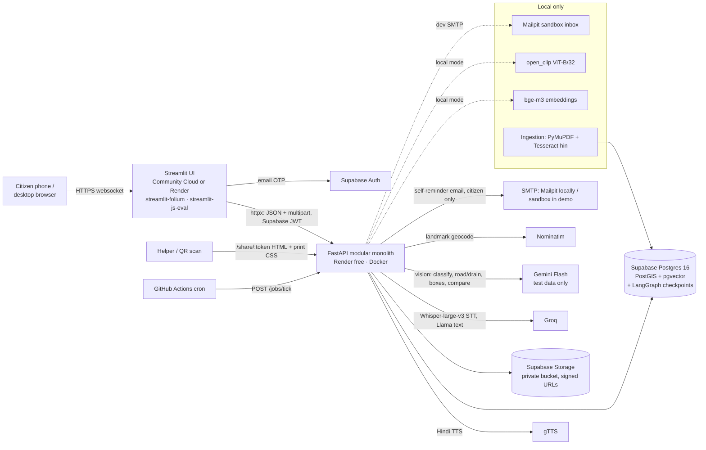
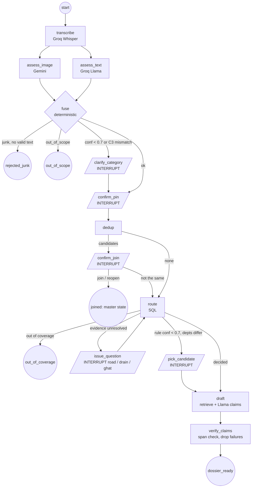
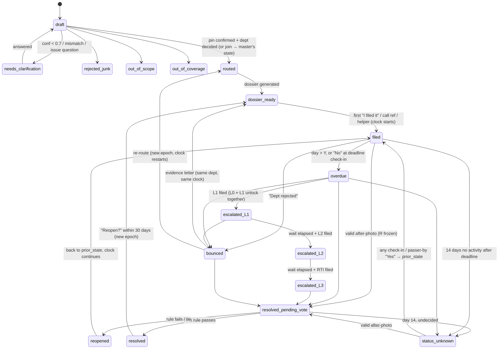

# ARCHITECTURE: Civic Grievance Router

| | |
|---|---|
| **Author** | Tech Lead · 2026-10-24 |
| **Inputs** | TECH-MEETING-01.md (final, incl. User decisions + Q-1…Q-20), PRD.md (§14 overrides), REQUIREMENTS.md, UX.md |
| **Precedence** | Meeting notes > REQUIREMENTS/UX where they conflict |
| **Principles** | Modular monolith · boring tech · deterministic where possible · LLM only where it must judge language or pixels · every threshold in one config |
| **UI** | **Streamlit** (user's choice, replaces the React PWA; ADR-15). Streamlit is a thin client of the FastAPI API: service layer, API contract and tests are unchanged |

---

## 0. Simplicity pass (user, 2026-10-24): overrides the detail below

The builder is a final-year student, and every part must be explainable in an interview. Where a later section is more complex, **this table wins**:

| Area | Was (below) | v1 builds this instead |
|---|---|---|
| PII encryption | Fernet with key IDs + rotation script + HMAC lookup columns | **One Fernet key** in env. Email lives in Supabase Auth only, so there is no email/HMAC column. Phone is optional and encrypted |
| Retrieval | FTS + vector + Reciprocal Rank Fusion | **Rule's pinned citations first, then Qdrant top-5** (FTS only in the hosted demo) |
| **Eval / monitoring / perf (user, 2026-10-28)** | Ragas only; no tracing; no load test | **Ragas + DeepEval** (eval), **Langfuse** Cloud free (tracing: `@observe` on graph nodes + the Langfuse LangChain callback for LangGraph; masked inputs only), **Locust** (`perf/locustfile.py`, POST /reports at N users) |
| **Vector store (user, 2026-10-28)** | pgvector columns (`chunk.embedding`, `media.clip`) inside Postgres | **Qdrant** (Docker locally, Qdrant Cloud free for the demo). Collections `rule_chunks` (bge-m3, 1024-d, cosine) and `photos` (CLIP ViT-B/32, 512-d, cosine). **Point id = Postgres row id** (`chunk.id` / `media.id`); the payload holds filter fields (doc_id, section_ref, page, lang / category, ward_no, master_id). Postgres keeps the chunk **text** for quoting and joins. pgvector columns are dropped (migration 0002). Cloud free tier pauses after ~1 week idle: keep-alive ping + `scripts/reindex_qdrant.py` rebuilds it from Postgres |
| Geometry | EPSG:32643 everywhere | **Store 4326**, use `::geography` for metre distances (one line to explain) |
| Provider modes | live / record / replay / demo | **Live + a simple JSON cache** (hit = reuse); tests use fakes |
| Blur | Gemini boxes ∪ Haar, fail-closed status | **OpenCV face blur**; if it errors, don't share the photo |
| Egress guard | SMTP helper + httpx event hooks | **One `send_email()`** that only sends to the logged-in user's own address |
| Share links | Hashed tokens, revoke, rate limit | **Random token** in the table, no revoke |
| Eval stats | Wilson CI, kappa, Ragas ×3 with variance | **Accuracy + Ragas once**; labeller agreement as a simple % on 20 cases |
| Extra tables | `pii_access_audit`, `notification_log`, `user_pref` | Drop the audit table; one `notifications` table; prefs as columns on `app_user` |
| CI | ruff, pytest, AppTest, Playwright e2e, gitleaks, tick, keepalive, backup, eval | **ruff + pytest + gitleaks**, plus the `tick` and `keepalive` crons. No e2e, no backups |
| **Voice input (user, 2026-10-25)** | Voice note → Groq Whisper STT, `st.audio_input`, `transcribe` node, STT benchmark | **Removed.** Input = photo + text (Hindi/English/Hinglish) + GPS. No STT model and no voice storage. Low-literacy users can use the phone keyboard's own mic-typing into the text box (no app code). Hindi read-aloud *output* (gTTS for Call mode) stays |
| **Report input (2026-10-27)** | `photos[]` (≤3) + `voice` + `meta` JSON with a GPS `fixes` list | **One `photo`**, `text`, `lat`/`lng`, optional `accuracy_m`, as plain form fields (§7). One photo keeps v1 simple: no "which photo is the evidence?" logic, one media row per report, one dedup embedding. Voice was already removed above |
| Code style | — | Short files, plain functions, no abstract base classes beyond the provider fakes, comments only where logic isn't obvious |

Everything not listed stays as designed.

---

## 1. System context & containers



**Hosting reality (read this):** Render free has 512 MB RAM, which cannot hold torch + bge-m3 + CLIP. So:
- **Local (dev + eval):** full pipeline, `LOCAL_MODELS=on`.
- **Hosted demo:** `LOCAL_MODELS=off`. Retrieval = Postgres FTS + the rule's pinned citations (corpus vectors are precomputed locally and loaded, but no query embedding). Dedup = location + category candidate list with user confirm (the Q-14 fallback path, which already exists). Demo scenarios run from the recorded cache (§10) so they show the full result.
- The eval runs locally (User decision 4). No metric is ever reported from the hosted mode.

### 1.1 Streamlit UI: constraints and workarounds

The Streamlit app (`ui/`) holds no business logic. It keeps `report_id`, the auth token and the current `ReportStep` in `st.session_state` and renders the screen that `next.kind` asks for (§7), so Streamlit's rerun-on-every-click model maps onto the API's step envelope.

| # | Constraint | Workaround |
|---|---|---|
| 1 | `st.camera_input` takes stills, no live view → no ghost overlay | **S3:** show the original photo as a reference above the camera ("take it from the same angle"), then the same 30 m check + vote. Intake capture = `st.camera_input` (in-app, `location_verified = true`); gallery = `st.file_uploader` (`location_verified = false`) |
| 2 | No built-in geolocation | `streamlit-js-eval` `get_geolocation()` read **when the camera opens and again at submit**. Pin seed = the better-accuracy fix of the two (Q-20); drift = accuracy > 50 m, reported speed > 3 m/s, or the two fixes > 30 m apart. Pin confirmed by clicking on a `streamlit-folium` map (OSM tiles); landmark text → `POST /geocode` |
| 3 | Audio capture | built-in `st.audio_input` (WAV) for the voice note |
| 4 | No web push, no service worker | **S7:** pending check-in cards (`GET /me/prompts`) shown at login and on Home; optional **self-reminder email to the citizen only** (sandbox / Mailpit in demo, never govt; egress guard §9) |
| 5 | Hindi read-aloud | server-side gTTS: `GET /tts?key=…` returns MP3, cached by text hash; played with `st.audio` |
| 6 | Call mode | `st.link_button("📞 Call now", "tel:1908")` + the script on screen in large text + 🔊 gTTS playback ("play script, then Call now", Q-19) |
| 7 | MSW mocks don't apply | Backend fakes + recorded cache (§10). `?scenario=` on the Streamlit URL is forwarded as header `X-Scenario`; the API honours it only when `APP_ENV != prod` and serves that scenario's fakes. Python Playwright drives the Streamlit UI in e2e |
| 8 | Hosting | Streamlit Community Cloud (free) or a second Render service; same warm-up script hits both |
| 9 | Mobile less polished | one `ui/style.css` injected via `st.markdown(unsafe_allow_html=True)`: ≥ 48 px buttons, large type, text-size setting (100/150/200%) |
| 10 | Photo pre-processing | done in the Streamlit Python process before upload: Pillow resize to ≤ 1280 px, brightness mean and OpenCV Laplacian variance for the S2 check |
| 11 | Draft survives only the session | pre-submit draft lives in `st.session_state` (lost on browser refresh); after submit, `GET /reports/{id}` resumes. Online-only (Q-9) |
| 12 | Share page + printable PDF need a plain page | FastAPI renders `/share/{token}` as a Jinja2 HTML page with print CSS + QR (browser shapes Devanagari), plus the helper "filed on their behalf" form. No Streamlit involved |

---

## 2. Backend modules

One FastAPI app, one DB, one process. Modules are Python packages that call each other directly; no message bus.

| Module | Responsibility | Kind |
|---|---|---|
| `intake` | LangGraph graph (§3); fuses model outputs into category/severity/confidence; junk + out-of-scope | **Graph**; nodes call LLMs |
| `location` | GPS drift rules (server re-check), landmark geocode (Nominatim, Delhi viewbox; fallback = ward-name centroid) | Deterministic (+ landmark extracted by the text LLM call) |
| `routing` | Ward → zone → road snap → PWD list → rule → confidence (§4) | **Deterministic SQL**. Called by a graph node |
| `rag` | Hybrid retrieval, structured claim generation, verbatim span check (§5) | Retrieval deterministic; generation = LLM; check deterministic |
| `dedup` | Candidate masters by distance/category/CLIP similarity | Deterministic (CLIP = local model, not an LLM) |
| `dossier` | Bilingual complaint, email draft (`mailto:` subject + copy body), deep link, call script, share page data | Templates + `rag` claims. Runs as the last graph node |
| `tracker` | Lifecycle state machine, `advance(master, now)`, deadlines, escalation ladder L0–L3, evidence letter / re-route | Deterministic; letter text via `rag` |
| `resolution` | After-photo check, AI compare (advisory), vote rounds | Deterministic + one vision call |
| `notify` | Pending check-in cards (in-app queue), optional self-reminder email to the citizen, gTTS audio, quiet hours, caps | Deterministic |
| `privacy` | Fernet + key ID, HMAC, masking, blur, egress guard, retention purge | Deterministic (blur boxes come from the vision call) |
| `jobs` | `/jobs/tick`: advance states, send nudges, purge | Deterministic, idempotent |
| `eval` | Harness, metrics, Ragas runner (lives in `/eval`, imports `app`) | Offline |
| `providers` | Thin ports + real clients + fakes + cache (§10) | Adapters |

Only `intake` uses LangGraph. Tracker, votes and escalation are a plain state machine in SQL rows.

---

## 3. LangGraph intake graph

Scope: intake → clarify → pin → dedup → route → draft. Routing and dedup are **tool nodes that call deterministic code**; the LLM never picks the department.



- **Parallel calls:** `assess_image` (only if a photo) returns `{category, confidence, junk, junk_reason, road_judgement, drain_type, face_boxes, plate_boxes}`; `assess_text` (only if transcript/text) returns `{category, confidence, severity, landmark}`. One vision call per photo, so blur boxes cost nothing extra.
- **fuse rules:** both present and both ≥ 0.7 and different → mismatch clarify (C3, P3; in P1 take the higher). One present → use it. `photo_quality = low` → text wins ties. Severity from text, else image. Clarify answer sets confidence 1.0.
- **Ask exactly one routing question** (`issue_question`): only the question whose answer can change the department (§4 step 6).
- **Checkpointer:** `AsyncPostgresSaver` in the same DB, `thread_id = report_id`. A reload calls `GET /reports/{id}` and gets the pending interrupt back. Checkpoints are purged with expired drafts (7 days).
- **Resume:** each step endpoint (§7) validates that its payload matches the pending interrupt kind (else `409 wrong_step`) and calls `graph.ainvoke(Command(resume=payload))`.
- **Eval:** the same graph runs with `scripted_answers` from the case file feeding each interrupt.

```python
class IntakeState(TypedDict, total=False):
    report_id: str; user_id: str; ui_lang: Literal["hi", "en"]
    photo_ids: list[str]; voice_id: str | None; text: str | None
    photo_quality: Literal["ok", "low"]; location_verified: bool
    transcript: str | None; transcript_lang: str | None
    image: ImageAssessment | None; text_assess: TextAssessment | None
    category: str | None; severity: str | None; intake_confidence: float | None
    pin: Pin | None                      # confirmed only
    master_id: str | None
    route: RouteResult | None            # from routing.engine
    answers: dict[str, str]              # question_id -> answer
    dossier_id: str | None
    terminal: str | None                 # rejected_junk | out_of_scope | out_of_coverage | joined
```

---

## 4. Routing algorithm (deterministic)

All geometry is stored in **EPSG:32643 (UTM 43N, metres)**; Delhi (≈77.2°E) sits inside the zone, so distances are plain `ST_Distance` in metres and GIST indexes work without `::geography` casts. The API speaks WGS84 (4326); `pin = ST_Transform(ST_SetSRID(ST_MakePoint(lng, lat), 4326), 32643)`.

1. **Ward.** `SELECT id, in_coverage FROM ward WHERE ST_Contains(geom, :pin)`. None or `in_coverage = false` → `out_of_coverage` (general channels, no claim). Also fetch other covered wards with `ST_DWithin(geom, :pin, 15)` → `ward_candidates` (boundary buffer).
2. **Special zones.** `SELECT * FROM special_zone WHERE ST_DWithin(geom, :pin, 15) ORDER BY priority`. Contained (`ST_Contains`) → that zone applies. Within 15 m but outside → both "zone" and "no zone" become candidates.
3. **Road snap.** `SELECT id, name, highway_class, row_class, row_source, ST_Distance(geom, :pin) AS d FROM road_segment WHERE ST_DWithin(geom, :pin, 25) ORDER BY geom <-> :pin LIMIT 3`. Nearest = snapped segment. None → `road = none` → asset rules (open plot / ghat). If ≥ 2 segments have `d ≤ 15` and different `row_class` → road is ambiguous (junction, service lane, flyover).
4. **PWD list match.** Done **offline** (`scripts/match_pwd.py`): normalised name similarity (`difflib`, ≥ 0.85) plus the segment lying in a covered ward; the curator confirms each proposal in `data/pwd_matches.csv`. Confirmed → `row_class = ≥60ft`, `row_source = pwd_list`, `pwd_list_citation_id`. At runtime the column is just read. Unlisted = `unknown`, never "MCD by default".
5. **Asset + evidence.** Asset: pothole → `road`; streetlight → `streetlight`; garbage → `road` if snapped else `open_plot`; waterlogging → `sewer` / `drain` from the vision `drain_type` (`manhole_sewer | open_nala | unclear`). Road-class evidence, in order: `pwd_list` → `curated` → **image tie-break** (`wide_multilane` + OSM class ∈ {trunk, primary, secondary} → ≥60ft; `narrow_gali` + class ∈ {residential, service, living_street, unclassified} → <60ft; image conf ≥ 0.7 and the two agree → `inferred`; otherwise unresolved) → user answer.
6. **Candidates and the one question.** Evaluate the rule (step 7) for every combination of ward candidate × zone candidate × unresolved evidence value. **All give the same department → no question.** Otherwise ask the one question that splits them, matched to the issue type (Q-6):

   | Unresolved | `question_id` | Options |
   |---|---|---|
   | road class | `road_class` | "Main road or inner lane? / मेन रोड या अंदर की गली?" → `main_road / inner_lane / not_sure` |
   | sewer vs drain (Q-7) | `drain_type` | "Big open nala, or sewer line / manhole?" → `open_nala / sewer / not_sure` |
   | ghat zone edge | `ghat_position` | "On the river bank or in the water?" → `bank / water / not_sure` |

   If two would be needed, ask `drain_type` first; anything still split goes to `pick_candidate`. `not_sure` → `pick_candidate` (two cards with confidence words).
7. **Rule match.** First match by priority:
   ```sql
   SELECT * FROM routing_rule
   WHERE status <> 'retired' AND dataset_version = :frozen
     AND (ward_ids IS NULL OR :ward_id = ANY(ward_ids))
     AND category = :category
     AND special_zone = COALESCE(:zone_type, 'none')
     AND (row_class = 'n/a' OR row_class = :row_class)
     AND (asset IS NULL OR asset = :asset)
   ORDER BY priority LIMIT 1;
   ```
   No row → "no cited rule found", ward default civic body as best guess, suggested deadline.
8. **Confidence (recalibrated, Q-6).** The old product `rule × evidence` made every inferred MCD case ask. Split it:
   - `evidence_conf`: pwd_list 1.0 · curated 0.95 · user_answer 0.95 · inferred 0.85. **Drives the question** (step 6): asked only when evidence < 0.7 **and** candidates disagree.
   - `routing_confidence = rule.confidence × evidence_conf × citation_factor (1.0, or 0.8 if no citation) × staleness (0.9 if `last_verified` > 12 months)`. **Drives display + alternatives**: < 0.7 → `pick_candidate` (the user can answer "which department?" only by choosing; they cannot answer "is the ghat rule correct?"). The ghat rule at 0.6 therefore shows two candidates, not a road question.
   - All factor values start as above and are **grid-searched on the dev set only** (maximise dept accuracy with ask-when-unsure = 100%), then frozen with the dataset version before the test run.
9. Persist `routing_decision` (ward, zone, segment, snap_m, image judgement, answer, evidence, rule, dataset version, confidence, alternatives). Label output "curated data" + contact `last_verified`.

---

## 5. RAG design

**Ingestion** (`scripts/ingest_corpus.py`, runs in the `ingest` compose service so Tesseract `hin` works on Windows):
1. `data/corpus/manifest.yaml` lists each PolicyDoc (title, issuer, url, retrieved_at, doc_type, language).
2. PyMuPDF extracts text per page and inspects span fonts. A page goes to **OCR** when chars/page < 50 (scanned) **or** any span font matches `/kruti|devlys|walkman/i` (legacy KrutiDev-family encodings produce Latin gibberish). OCR = render at 300 dpi → `tesseract -l hin+eng`. Set `ocr = true`.
3. Normalise: Unicode **NFC**, strip zero-width chars (ZWJ/ZWNJ kept only inside Devanagari conjuncts), collapse whitespace, Devanagari digits → ASCII in `text_norm` (original `text` kept for quoting).
4. **Section chunking:** split on clause headings (`^\s*(\d+(\.\d+)*|\([a-z]\)|धारा|Section|Clause|नियम)\b`), merge chunks < 80 tokens, split > 450 tokens at sentence ends. Each chunk keeps `section_ref` and `page`.
5. bge-m3 dense vectors (1024-d) computed locally, written to `chunk.embedding`. The curator sets `manually_checked` per doc; ownership rules may only cite checked docs (load script enforces).

**Retrieval** (per routing context):
- Query = template from structured fields (category, asset, department code, zone, row_class) + the citizen's description, in HI and EN.
- **Pinned:** chunks behind `rule.source_citation_ids` and `rule.sla_citation_id` always go first.
- **FTS:** `to_tsvector('simple', text_norm)` (Postgres has no Hindi stemmer; `simple` works for both scripts), `websearch_to_tsquery`, top 20.
- **Vector** (local mode only): `ORDER BY embedding <=> :q LIMIT 20`.
- Fuse with Reciprocal Rank Fusion (k = 60), take pinned + top 6.

**Generation:** Groq Llama in JSON mode with chunks labelled `[C1]…[Cn]`. Output schema (Pydantic-validated):
```json
{"claims": [{"claim_en": "...", "claim_hi": "...", "citation_id": "C2", "quoted_span": "exact words from C2"}]}
```
- **Numbers never come from the LLM.** Department, SLA days, due date and helpline come from the rule/contact rows and are rendered by templates. The LLM writes only the "why" sentences and letter prose.
- **Verbatim check** (`rag/verify.py`): `citation_id` must be in the context set; `normalise(quoted_span)` must be a substring of `normalise(chunk.text)` (same NFC/whitespace/digit normalisation as ingestion). Failing claims are **dropped**, never repaired. If the ownership claim is dropped → the exact text "no cited rule found" / "कोई उद्धृत नियम नहीं मिला", × 0.8 confidence, deadline labelled "Suggested deadline (no official rule found)" / "सुझाई गई समय-सीमा (कोई आधिकारिक नियम नहीं मिला)".
- User-provided description is rendered as "as reported by the citizen", not as a claim. Result: uncited claims = 0 by construction, and the CI test re-checks every generated fixture.

---

## 6. Data model

Postgres 16, extensions `postgis`, `vector`. Geometry SRID **32643** unless noted. `🔒` = Fernet ciphertext `bytea` (§9). Migrations: Alembic. ORM: SQLAlchemy 2 + GeoAlchemy2; PostGIS queries are written as SQL text.

| Table | Key columns | Indexes |
|---|---|---|
| `app_user` | `id uuid` (= Supabase auth uid), `email🔒`, `email_hmac`, `name🔒`, `phone🔒`, `phone_hmac`, `key_id smallint`, `preferred_language`, `privacy_accepted_at`, `deleted_at` | unique `email_hmac`, `phone_hmac` |
| `ward` | `ward_no`, `name_en/hi`, `mcd_zone`, `civic_body`, `geom MultiPolygon`, `in_coverage`, `source`, `version` | GIST `geom` |
| `special_zone` | `type`, `name`, `geom MultiPolygon`, `priority`, `source_citation_id`, `last_verified` | GIST |
| `road_segment` | `osm_way_id`, `name`, `highway_class`, `geom LineString`, `pwd_listed`, `pwd_list_citation_id`, `row_class`, `row_source`, `confidence`, `last_verified` | GIST, btree `osm_way_id` |
| `department` / `contact` | `code`, names; contact: `channel_type`, `value`, `deep_link`, `scope`, `designation`, `last_verified`, `source_url` | |
| `routing_rule` | `priority`, `ward_ids int[]`, `category`, `row_class`, `special_zone`, `asset`, `department_id`, `sla_days`, `sla_citation_id`, `source_citation_ids int[]`, `confidence`, `status`, `dataset_version`, `last_verified` | btree `(dataset_version, category, priority)` |
| `dataset_version` | `id`, `frozen_at`, `sha256` of all `data/` files | |
| `policy_doc` | manifest fields, `ocr`, `manually_checked` | |
| `chunk` | `doc_id`, `section_ref`, `page`, `text`, `text_norm`, `lang`, `tsv tsvector GENERATED`, `embedding vector(1024)` | GIN `tsv`; HNSW `embedding vector_cosine_ops` (≈3k rows, exact scan would also do) |
| `citation` | curated: `chunk_id`, `quoted_span` | |
| `media` | `owner_id`, `kind` (photo/voice/after_photo), `storage_key`, `blurred_key`, `blur_status` (ok/failed), `clip vector(512)`, `quality`, `purge_after` | HNSW `clip` (local) |
| `report` | `user_id`, `master_id`, `state`, `text🔒`, `transcript🔒`, `transcript_lang`, `category`, `severity`, `intake_confidence`, `intake jsonb` (raw model outputs), `junk_reason`, `photo_quality`, `location_verified`, `capture_gps jsonb`, `pin Point`, `pin_source`, `drag_m`, `landmark_text🔒`, `filed_channel`, `ref_no`, `filed_at`, `filed_by`, `routing_epoch`, `opt_in_identity`, `expires_at` | GIST `pin`; btree `(user_id, created_at)` for rate limits |
| `master_issue` | `category`, `centroid Point` (= first pin), `ward_id`, `representative_media_id`, `department_id`, `routing_rule_id`, `routing_confidence`, `alternatives jsonb`, `routing_epoch`, `clock_started_at`, `sla_days`, `deadline_cited`, `sla_citation_id`, `state`, `prior_state`, `last_seen_at`, `last_activity_at`, `previous_master_id`, `resolved_at`, `is_sample` | GIST `centroid`; btree `(category, state)` |
| `master_reporter` | PK `(master_id, user_id)`, `report_id`, `joined_at` | gives distinct N |
| `routing_decision` | `report_id`, `master_id`, `epoch`, ward/zone/segment ids, `snap_m`, `image_judgement jsonb`, `user_answer`, `evidence`, `rule_id`, `dataset_version`, `confidence` | |
| `dossier` | `master_id`, `report_id`, `version`, `epoch`, `complaint_hi/en`, `claims jsonb`, `email_draft jsonb`, `deep_link`, `call_script_hi/en`, `deadline jsonb`, `reporter_count`, `prompt_version`, `generation_ms` | |
| `share_link` | `report_id`, `token_sha256`, `revoked_at`, `helper_ref_no`, `helper_filed_at` | unique `token_sha256` |
| `escalation_step` | `report_id`, `epoch`, `level` (L0–L3, evidence_letter), `draft jsonb`, `citation_ids`, `unlocked_at`, `due_at`, `filed_at`, `ref_no` | |
| `vote_round` | `master_id`, `after_media_id`, `submitter_id`, `r_frozen`, `ai_score`, `distance_m`, `accuracy_m`, `opened_at`, `closed_at`, `outcome` | |
| `resolution_vote` | PK `(round_id, user_id)`, `vote` | |
| `check_in` | `master_id`, `user_id`, `kind`, `checkpoint`, `answer`, `distance_m` | |
| `notification_log` | unique `(master_id, user_id, checkpoint, epoch)` | makes tick idempotent |
| `user_pref` | `user_id`, `reminder_email_opt_in`, `text_size` | |
| `outcome_feedback` (P3) | `report_id`, `routing_rule_id`, `outcome`, `bounced_to_dept_id` | |
| `pii_access_audit` | `actor`, `user_id`, `reason`, `at` | |

RLS is **enabled with no policies** on every table: the browser never talks to the DB, only the API (service role) does.

---

## 7. API contract

Base `/api/v1`. Auth: `Authorization: Bearer <Supabase JWT>` except `/share/*`, `/healthz`, `/jobs/tick` (job token). Pydantic models in `app/schemas.py` are the source of truth, and the Streamlit client imports the same models (`ui/` depends on `backend/app/schemas.py`), so client and server cannot drift. Scenario fixtures live in `backend/tests/fixtures/scenarios/<scenario>/` and a test validates them against these models.

**Error shape:** `{"error": {"code": "rate_limited|wrong_step|too_far|gallery_not_allowed|not_reporter|validation", "message_key": "E09", "detail": {}}}`.

**The `ReportStep` envelope** is returned by every intake step:
```json
{
  "report_id": "7c1e…", "state": "needs_clarification",
  "next": { "kind": "clarify_category", "...": "kind-specific fields below" },
  "master_id": null, "dossier_id": null, "notices": ["photo_low_quality"]
}
```

| `next.kind` | Payload | Resume endpoint + body |
|---|---|---|
| `clarify_category` | `{"options":[{"category":"pothole","confidence":0.55},{"category":"waterlogging_sewage","confidence":0.31}],"allow_other":true,"mismatch":null}` | `POST /reports/{id}/clarify` `{"category":"pothole"}` |
| `confirm_pin` | `{"seed":{"lat":28.5412,"lng":77.3105,"accuracy_m":62,"source":"gps"},"warning":"low_accuracy\|moving\|null"}` | `POST /reports/{id}/pin` `{"lat":…,"lng":…,"pin_source":"gps_dragged","drag_m":14,"landmark_text":null}` |
| `confirm_join` | `{"candidates":[{"master_id":"…","distance_m":22,"match":"image\|location_only","similarity":0.91,"reporter_count":3,"state":"filed","offer":"join\|reopen","photo_url":"signed…"}]}` | `POST /reports/{id}/join` `{"master_id":"…"}` or `{"decline":true}` |
| `issue_question` | `{"question_id":"road_class\|drain_type\|ghat_position","options":["main_road","inner_lane","not_sure"]}` | `POST /reports/{id}/route` `{"question_id":"road_class","answer":"inner_lane"}` |
| `pick_candidate` | `{"candidates":[{"department":{"code":"MCD","name_en":"…","name_hi":"…"},"confidence":0.62,"confidence_label":"likely","reason_key":"ghat_owner_unverified","rule_id":41}]}` | `POST /reports/{id}/route` `{"department_code":"MCD"}` |
| `retake_photo` / `general_channels` | terminal for `rejected_junk` / `out_of_scope` / `out_of_coverage`: `{"reason":"selfie"}` / `{"channels":[{"label":"MCD 311","value":"155305","deep_link":"tel:155305"}]}` | none |
| `null` | `state = dossier_ready` with `dossier_id`, or the joined master's state with `master_id` | |

| Endpoint | Request | Response |
|---|---|---|
| `POST /reports` | multipart: `photo` (one JPEG/PNG, ≤5 MB), `text` (≤1000), `lat` + `lng` (both or neither), `accuracy_m` (optional), `ui_lang` (`hi`\|`en`); photo or text required (see §0) | `201 ReportStep` (runs graph to first interrupt) · `429` rate limit |
| `GET /reports/{id}` | | `ReportStep` (pending interrupt, for resume after reload) |
| `POST /geocode` | `{"text":"sarkari school ke saamne, Jaitpur"}` | `{"candidates":[{"lat":…,"lng":…,"label":"…","source":"nominatim\|ward_centroid"}]}` |
| `GET /dossiers/{id}` | | `Dossier` (below) |
| `POST /reports/{id}/filed` | `{"channel":"portal\|app\|email\|phone\|in_person","ref_no":"PWD/123","filed_at":"2026-10-24"}` | `{"master_state":"filed","clock_started_at":"…","due_date":"…","day":0,"of":15,"deadline_label":"official\|suggested"}` |
| `POST /reports/{id}/share-links` · `DELETE /share-links/{id}` | | `{"id":"…","url":"https://…/share/<token>"}` (token shown once) |
| `GET /share/{token}` · `POST /share/{token}/filed` | helper form: `ref_no`, `channel` | masked HTML page (print CSS + QR; `Accept: application/json` → masked `Dossier`) · `410` revoked ("link no longer active") |
| `GET /tts?key=call_script:{report_id}:hi` | key names a server-side masked text (never free text from the client) | `audio/mpeg` (gTTS, cached by text hash) |
| `GET /masters/{id}/tracker` | | `{"state":"overdue","day":17,"of":15,"deadline_label":"suggested","reporter_count":4,"next_step":{"level":"L1","unlocked":true,"unlock_at":null},"steps":[…],"history":[{"epoch":1,"department":"MCD","steps":[…]}],"last_seen_at":"…"}` |
| `GET /reports/{id}/escalations/{level}` · `POST …/{level}/filed` | `{"ref_no":"…","filed_at":"…"}` | `{"level":"L1","draft_hi":"…","draft_en":"…","target":{"designation":"Nodal Officer (PG)","channel":"email"},"claims":[…],"due_at":"…"}` |
| `POST /reports/{id}/rejected` | `{"said_dept_code":"DJB\|other\|unknown"}` | `{"recommendation":"evidence_letter\|reroute","evidence_letter":{"draft_hi":"…","draft_en":"…","claims":[…]},"reroute":{"department":{…},"reason_key":"…","confidence":0.8}}` |
| `POST /reports/{id}/reroute` | `{"department_code":"DJB"}` | `ReportStep` (`dossier_ready`, new epoch) |
| `POST /masters/{id}/after-photo` | multipart `photo`, `meta {"lat","lng","accuracy_m","in_app":true}` | `201 {"round_id":"…","ai_score":"looks_fixed\|looks_not_fixed\|unclear","r_frozen":2,"state":"resolved_pending_vote\|resolved"}` · `422 too_far {"distance_m":120}` · `422 gallery_not_allowed` |
| `POST /masters/{id}/vote` | `{"vote":"fixed\|not_fixed"}` | `{"state":"resolved_pending_vote\|resolved\|status_unknown\|<prior>","tally":{"fixed":2,"not_fixed":0,"r":3}}` |
| `POST /masters/{id}/checkin` | `{"kind":"reporter_nudge\|passer_by","checkpoint":"day3\|day7\|deadline\|adhoc","answer":"yes_working\|no\|fixed\|still_here\|gone\|not_sure","lat":…,"lng":…}` | `{"state":"…","open_after_photo":true}` |
| `GET /nearby?lat&lng` | | `{"prompts":[{"master_id":"…","category":"streetlight","photo_url":"blurred…"}]}` (≤50 m, not a reporter, once/7 days) |
| `GET /me/prompts` | | `{"prompts":[{"master_id":"…","checkpoint":"day3","question_key":"anyone_came","answers":["yes_working","no","fixed"]},{"report_id":"…","checkpoint":"unfiled_day1","question_key":"did_you_file"}]}` (shown at login + Home) |
| `PUT /me/prefs` | `{"reminder_email_opt_in":true,"text_size":150}` | `204` |
| `DELETE /me` | | `202` (PII purged ≤ 7 days) |
| `POST /jobs/tick` | header `Authorization: Bearer $JOB_TOKEN` | `{"ran_at":"…","transitions":{"overdue":2,"status_unknown":1,"vote_closed":1},"nudges":{"cards":7,"emails":2,"skipped_quiet":3},"purged":{"drafts":4,"voice":1,"pii":0}}` |
| `GET /healthz` | `?db=1` touches the DB (Supabase keep-alive) | `{"ok":true}` |
| P3: `POST /outcomes`, `GET /scoreboard` | | |

**Dossier shape:**
```json
{
  "id": "…", "version": 2, "master_id": "…", "location_verified": false,
  "category": "pothole", "severity": "high",
  "pin": {"lat": 28.54, "lng": 77.31, "ward_no": 187, "ward_name": "Sarita Vihar", "landmark": "…"},
  "department": {"code": "PWD", "name_en": "…", "name_hi": "…"},
  "routing": {"confidence_label": "very_likely", "evidence": ["pwd_list"], "curated": true, "contact_last_verified": "2026-10-01"},
  "complaint": {"hi": "…", "en": "…"},
  "claims": [{"claim_en": "…", "claim_hi": "…", "doc_title": "…", "section_ref": "Cl. 3", "page": 2, "quoted_span": "…"}],
  "deadline": {"sla_days": 15, "due_date": null, "label": "official|suggested", "citation": null},
  "reporter_count": 4,
  "channels": [{"type": "helpline", "value": "1908", "deep_link": "tel:1908"}, {"type": "email", "value": "…", "mailto": "mailto:…?subject=…"}],
  "email_body": "…", "call_script": {"hi": "…", "en": "…"},
  "photos": [{"url": "signed-blurred-url", "withheld": false}]
}
```

**`?scenario=` names** (Streamlit URL → `X-Scenario` header → backend fake set, non-prod only; the same names are eval/e2e tags): `happy_pwd_pothole`, `low_conf_clarify`, `mismatch_c3`, `junk_selfie`, `out_of_scope`, `out_of_coverage`, `gps_drift`, `no_gps_landmark`, `road_question`, `drain_question`, `ghat_question`, `pick_candidate`, `dedup_join`, `dedup_location_only`, `dedup_reopen`, `no_rule`, `filed_call_mode`, `helper_filed`, `overdue_l1`, `rejected_evidence`, `rejected_reroute`, `after_photo_too_far`, `vote_r1`, `vote_r2`, `vote_r3`, `status_unknown`, `rate_limited`, `slow_network`.

---

## 8. Lifecycle state machine (MasterIssue)

Report-only states before a master exists: `draft`, `needs_clarification`, `rejected_junk`, `out_of_scope`, `out_of_coverage`. After routing or join, a report mirrors its master.


(Escalated L2/L3 have the same bounced / pending-vote / status_unknown edges as L1; omitted for readability. `reopened` and `status_unknown` return to `prior_state`, drawn as `filed`.)

**Rules the code enforces (`tracker/lifecycle.py`):**
- **Master clock (Q-10):** `clock_started_at` = first `filed_at` among reporters in the current `routing_epoch`. Later reporters inherit it. `day X of Y` = computed on read from `clock_started_at` + `sla_days`; nothing is scheduled for it.
- **Re-route (Q-11):** `routing_epoch += 1`, new department/rule/SLA, `clock_started_at = NULL` until someone files with the new department. Old escalation steps stay under their epoch (shown as history). On `rejected`, if the rule still says it is the original department's, the evidence letter is recommended first.
- **Escalation:** master state = the highest level filed by any reporter in the epoch; unlock waits are per report (each citizen files their own). L0 + L1 unlock at overdue (Q-5).
- **Votes (Q-1, Q-2):** `r_frozen` = distinct reporters at after-photo upload. R=1 → resolved on the valid photo (AI advisory, shown). R=2 → **both** must vote fixed; any not_fixed → reopened; one fixed at day 14 → status_unknown. AI is never a vote. R≥3 → before day 7 only early-close when everyone voted; from day 7, decide if ≥ 2 votes cast (fixed strict majority and ≥ 2 fixed → resolved, else reopened); fewer than 2 votes → wait until day 14 → status_unknown.
- **Time-driven transitions** live in one pure function `advance(master, now) -> (new_state, events)`. It runs on every read of a master (persisted in the same transaction) and in `/jobs/tick`. Same input → same output, so tick is idempotent.
- **Nudges (no push, ADR-15):** tick creates pending check-in cards: dossier_ready day 1 + 3 "Did you file it?" (Q-13); filed day 3, 7, deadline. Cards show at login and on Home for every reporter. If opted in, one self-reminder email to the citizen (quiet 22:00–07:00 IST, ≤ 3/user/day). `notification_log` unique key prevents doubles.
- `status_unknown` never counts as resolved; no transition reaches `resolved` except via the vote rule.

---

## 9. Privacy & security

| Control | Design |
|---|---|
| **Field encryption** | `cryptography.Fernet`. Env `PII_KEYS='{"1":"<key>","2":"<key>"}'` + `PII_ACTIVE_KEY_ID`. Each row stores `key_id`; `scripts/rotate_keys.py` re-encrypts old rows. Keys never in the DB or repo. |
| **Lookup** | `HMAC-SHA256(PII_HMAC_KEY, normalise(email/phone))` in `*_hmac` columns with unique indexes. |
| **Masking** (`privacy/mask.py`) | Before regex: Devanagari digits → ASCII, Hindi/English number words ("नौ आठ…", "nine eight…") → digits (Q-17). Phone → `98XXXXXX12`, email → `p***@g***.com`, name → first name + initial or "A resident". Runs on every outbound artifact (dossier, letters, script, share page, tweet). CI scans all generated fixtures: 0 matches. |
| **Blur, fail-closed** | Boxes = Gemini face/plate boxes ∪ OpenCV Haar faces; Pillow `GaussianBlur` per box. `blur_status = ok` only if the vision call returned a valid detection object (an explicit empty list is valid). Error, timeout or malformed output → `failed` → photo **excluded** from every shared output ("Photo withheld for privacy"). Originals are visible only to their owner. |
| **Media access** | Private bucket. Supabase signed URLs (10 min); local storage adapter signs `/media/{key}?exp&sig` with HMAC. Never public URLs. |
| **Share tokens** | `secrets.token_urlsafe(32)`, only SHA-256 stored, shown once, revocable, rate-limited lookup, redacted from logs (`/share/****`). Share view is masked and read-only except "filed on their behalf". |
| **Gov-domain egress block** | The app never sends complaints. The only email it sends is the optional self-reminder to the citizen's own address. The single SMTP helper (`privacy/egress.py`) hard-blocks `*.gov.in`, `*.nic.in`, `*.delhi.gov.in` always, and in local/demo allows only `SANDBOX_EMAIL_DOMAINS` (Mailpit / sandbox inbox); recipient must equal the signed-in user's decrypted email. An `httpx` event hook refuses the same gov hosts. CI test: real domain → `EgressBlocked`. Reminder bodies are masked and carry no complaint text. |
| **Auth** | Supabase Auth email OTP, called from the Streamlit server (`supabase-py` `sign_in_with_otp` / `verify_otp`); the JWT lives in `st.session_state` only. Google sign-in deferred (OAuth redirect in Streamlit is fiddly). API verifies the JWT (`SUPABASE_JWT_SECRET`). Streamlit holds no service key. Local: `AUTH_MODE=dev` enables `/auth/dev-login` issuing a JWT for seed users; the app refuses to start with `AUTH_MODE=dev` unless `APP_ENV=local`. |
| **Other** | No CORS (no browser calls the API except the share page, served same-origin). RLS deny-all. Rate limits via DB counts (BR-4). Retention purge in tick (NFR-PRIV-1). PII decrypt only via `scripts/pii_lookup.py`, which writes `pii_access_audit`. **gitleaks** in pre-commit and CI. `.env` git-ignored; `.env.example` has dummy values only. |

---

## 10. Model / provider abstraction

`app/providers/ports.py` holds small `Protocol`s; each has one real client and one fake (the fake is what makes tests free):

| Port | Real | Fake |
|---|---|---|
| `STT.transcribe(audio, hint) -> Transcript` | Groq `whisper-large-v3` (Sarvam client exists only in `eval/stt_bench.py` until it wins) | returns case transcript |
| `Vision.assess(img) -> ImageAssessment` · `Vision.compare(before, after)` | Gemini Flash, JSON schema output | scripted per fixture |
| `LLM.json(prompt_id, vars, schema)` | Groq Llama, JSON mode | scripted |
| `TextEmbedder` / `ImageEmbedder` | bge-m3 / open_clip ViT-B/32 (CPU, lazy-loaded) | deterministic hash vectors |
| `Geocoder` · `Storage` · `TTS` | Nominatim · Supabase Storage / local disk · gTTS | dict · temp dir · silent MP3 |

- **Cache wrapper** (`providers/cache.py`): key = `sha256(input bytes + model name + prompt_version)`; value = JSON file in `CACHE_DIR` (fixtures committed under `backend/tests/fixtures/llm/` and `eval/cache/`). `PROVIDER_MODE`: `live` · `record` (read-through, write on miss) · `replay` (miss = error; CI and eval re-runs) · `demo` (cache first, live on miss; hosted demo).
- **Prompts** live in `backend/prompts/*.md` with `version:` front matter; bumping the version invalidates the cache on purpose.
- **Rate limits:** one `asyncio.Semaphore` per provider (`GROQ_CONCURRENCY=2`, `GEMINI_CONCURRENCY=1`) + `tenacity` exponential backoff with jitter on 429/5xx, honours `Retry-After`, max 5 tries. Then the user keeps their draft and sees retry (NFR-REL-1).
- **Model names are config only** (`STT_MODEL`, `TEXT_MODEL`, `VISION_MODEL`, `JUDGE_MODEL`). Gemini receives only test/demo data (User decision 2).

---

## 11. Eval harness (`/eval`)

- **Split:** `eval/cases/dev/` (50, used for every threshold and factor) and `eval/cases/test/` (100, frozen). `eval/test.lock` stores the SHA-256 of every test case + media file. `run.py --final` checks the lock and the frozen `dataset_version`, refuses on mismatch, and is the only code path that reads `test/`. `tune.py` imports only `dev/`.
- **Case format:** YAML following the REQUIREMENTS §11 label schema, incl. `scripted_answers`, `label_source`, `labeller`. Labels come from the second labeller (User decision 5), blind to `routing_rule`.
- **Runner:** drives the real graph end-to-end (photo + voice + pin/landmark) in `record` mode, writes one JSONL row per case to `eval/runs/<date>/`, and skips finished cases, so batches resume after a rate-limit stop.
- **Per-stage metrics + first failing stage:** intake (category accuracy, junk precision/recall, ask-rate, ask-when-unsure = 100%), location (ward accuracy, landmark ≤ 100 m), road (segment, row_class, question rate), routing (dept accuracy), citation, end-to-end. Also dedup precision/recall on ≥ 60 pairs (incl. 45–55 m hard negatives), resolution compare on ≥ 20 pairs, p50/p90 latency, uncited claims.
- **Correctness metric** (deterministic, next to Ragas): predicted dept == expected, `sla_days` == expected, cited `(doc_id, section_ref)` == gold.
- **Ragas × 3:** faithfulness, context precision, context recall; judge = `JUDGE_MODEL` (not the generator model); report mean ± std of 3 runs.
- **Honesty:** accuracy reported with Wilson 95% CI (n = 100 → about ±7 points). **Cohen's kappa** on ≥ 20 double-labelled cases (stdlib, ~10 lines).
- **STT benchmark:** `eval/stt_bench.py`, WER (jiwer) of Groq vs Sarvam on ~30 real-speaker clips; the winner goes into `STT_MODEL`.
- Output: `eval/reports/<date>.md` with dataset version, prompt versions, model names.

---

## 12. Dev & deploy

**Local (Windows):** Docker Desktop + `uv` (Python 3.12). No Node toolchain.
```yaml
# infra/docker-compose.yml
services:
  db:      { build: ./db, ports: ["5433:5432"], environment: { POSTGRES_PASSWORD: dev } }
           # infra/db/Dockerfile: FROM postgis/postgis:16-3.4 + apt postgresql-16-pgvector
  mailpit: { image: axllent/mailpit:v1.20, ports: ["8025:8025", "1025:1025"] }
  ingest:  { build: ./ingest, profiles: [tools], volumes: ["../data:/data"] }
           # python + tesseract-ocr + tesseract-ocr-hin + PyMuPDF
```
API: `uv run uvicorn app.main:app --reload`. UI: `uv run streamlit run ui/app.py` (point `API_URL` at a `PROVIDER_MODE=replay` API to click through scenarios without spending API calls). Note: `streamlit-js-eval` geolocation needs HTTPS or `localhost`; test on a phone via the deployed URL.

**Env vars:** `APP_ENV` · `DATABASE_URL` · `AUTH_MODE` · `SUPABASE_URL` · `SUPABASE_JWT_SECRET` · `SUPABASE_SERVICE_KEY` · `STORAGE_BACKEND` (`supabase|local`) · `MEDIA_DIR` · `MEDIA_SIGNING_KEY` · `PII_KEYS` · `PII_ACTIVE_KEY_ID` · `PII_HMAC_KEY` · `GROQ_API_KEY` · `GEMINI_API_KEY` · `STT_MODEL` · `TEXT_MODEL` · `VISION_MODEL` · `JUDGE_MODEL` · `PROVIDER_MODE` · `CACHE_DIR` · `LOCAL_MODELS` · `NOMINATIM_USER_AGENT` · `JOB_TOKEN` · `SMTP_URL` · `SANDBOX_EMAIL_DOMAINS` · `PUBLIC_BASE_URL` (share links/QR) · `DATASET_VERSION` · UI (`ui/.streamlit/secrets.toml`, git-ignored): `API_URL`, `SUPABASE_URL`, `SUPABASE_ANON_KEY`. No CORS needed (Streamlit calls the API server-to-server).

**CI (GitHub Actions):**

| Workflow | Trigger | Jobs |
|---|---|---|
| `ci.yml` | push / PR | **backend**: ruff, pytest (`docker compose up db`, `PROVIDER_MODE=replay`, fakes; includes fixture-schema test, masking scan, egress test, routing SQL tests on seed geometry, vote/lifecycle tables) · **ui**: ruff + `streamlit.testing.v1.AppTest` smoke per screen · **e2e**: Python Playwright against Streamlit + a `replay`-mode API, with fake geolocation, fake camera/mic (`--use-fake-device-for-media-stream`) and `?scenario=` · **gitleaks** |
| `tick.yml` | cron `*/30 * * * *` | `curl -X POST $API/jobs/tick` with `JOB_TOKEN` |
| `keepalive.yml` | daily | `GET /healthz?db=1` (stops the Supabase 7-day pause) |
| `backup.yml` | weekly | `pg_dump` → encrypted with `age` → artifact, 7-day retention (repo may be public) |
| `eval.yml` | manual only | replay-mode eval smoke on dev set; real eval runs locally |

**Deploy:** API → Render (Docker, `LOCAL_MODELS=off`, `PROVIDER_MODE=demo`); UI → Streamlit Community Cloud (free; or a second Render service); DB/Auth/Storage → Supabase. Corpus + dataset loaded with `scripts/load_dataset.py` from the laptop. Migrations run on deploy (`alembic upgrade head`).

**Demo warm-up:** `scripts/warmup.sh` 10 min before: open the Streamlit URL (wakes a sleeping Community Cloud app), hit `/healthz?db=1`, run the 3 demo scenarios (Kalindi Kunj ghat, PWD pothole + Call mode, Kamla ji join) through the API so the cache and the Render instance are hot. Recorded backup video kept alongside.

---

## 13. Config values (`backend/app/config.py`, one `Settings` class, env-overridable)

| Key | Value | Source |
|---|---|---|
| `ASK_THRESHOLD` | 0.7 | PRD §13 |
| `MAX_PHOTOS` · `PHOTO_MAX_PX` · `VOICE_MAX_S` · `TEXT_MAX` | 3 · 1280 · 120 · 1000 | Meeting §3, FR-1.1 |
| `GPS_ACCURACY_MAX_M` · `GPS_SPEED_MAX` · `GPS_JUMP_M` (3 s) | 50 · 3 m/s · 30 | Meeting §3 |
| `PIN_SEED` | better-accuracy of the camera-open and submit fixes | Q-20, §1.1 |
| `PHOTO_DARK_MEAN` · `PHOTO_BLUR_LAPLACIAN` | < 60/255 · < 100 | Meeting §3 (in the Streamlit process) |
| `ROAD_SNAP_M` · `BOUNDARY_BUFFER_M` | 25 · 15 | Meeting §3 |
| `EVIDENCE` | pwd_list 1.0 · curated 0.95 · user_answer 0.95 · inferred 0.85 | start; tuned on dev |
| `NO_CITATION_FACTOR` · `STALE_FACTOR` (> 12 mo) | 0.8 · 0.9 | FR-4.3, REQ §9 |
| `DEDUP_RADIUS_M` · `CLIP_SIM_MIN` · `RESOLVED_MATCH_DAYS` | 50 · 0.85 · 30 | tuned on dev |
| `RESOLUTION_RADIUS_M` | 30, test `distance − accuracy ≤ 30` | Meeting §3 |
| `SUGGESTED_SLA_DAYS` · `L1_WAIT` · `L2_WAIT` · `RTI_REPLY` | 15 · 15 · 30 · 30 (cited) | REQ §6 |
| `VOTE_WINDOW_D` · `VOTE_TIMEOUT_D` · `UNKNOWN_AFTER_DEADLINE_D` | 7 · 14 · 14 | FR-9, FR-14.5 |
| `NUDGE_FILED_DAYS` · `NUDGE_UNFILED_DAYS` | [3, 7, deadline] · [1, 3] | FR-14.1, Q-13 |
| `QUIET_HOURS_IST` · `MAX_REMINDER_EMAILS_PER_DAY` | 22–07 · 3 | FR-14.3 |
| `PASSERBY_RADIUS_M` · `PASSERBY_COOLDOWN_D` | 50 · 7 | FR-14.4 |
| `RATE_REPORTS_DAY` · `RATE_SAME_SPOT_H` · `JUNK_LIMIT` | 10 · 24 h/50 m · 3 in 10 min → 15 min cooldown | BR-4 |
| `DRAFT_EXPIRY_D` · `VOICE_RETENTION` · `PHOTO_RETENTION` · `PII_DELETE_D` | 7 · 30 d after resolved or 90 d · open + 90 d · 7 | NFR-PRIV-1 |
| `CONTACT_STALE_D` · `C1_FLAG` | 90 · 3 distinct masters / 60 d | REQ §7.2, Q-12 |
| `FTS_K` · `VEC_K` · `RRF_K` · `CONTEXT_K` | 20 · 20 · 60 · 6 | §5 |
| `SIGNED_URL_TTL_S` | 600 | NFR-SEC-2 |
| `GROQ_CONCURRENCY` · `GEMINI_CONCURRENCY` · `MAX_RETRIES` | 2 · 1 · 5 | §10 |
| `COVERED_WARDS` | 8 now → 20 | User decision 3 |

---

## 14. Key decisions (ADR-style)

| # | Decision | Rejected alternatives | Why |
|---|---|---|---|
| ADR-1 | **Modular monolith** (FastAPI, one DB) | Microservices | One developer, free tiers; no network boundaries to debug |
| ADR-2 | **Postgres 16 + PostGIS** for geo, state, checkpoints; **Qdrant** for vectors (user decision 2026-10-28) | pgvector inside Postgres | Dedicated vector DB with payload filtering (ward/category) and its own HNSW tuning; the user wanted it. Cost: one more service, and the cloud free tier pauses when idle (keep-alive + re-index script) |
| ADR-3 | **Deterministic SQL routing**; the user answers one question or picks | LLM picks the department | Testable, explainable, citable; the LLM cannot invent jurisdiction |
| ADR-4 | **LangGraph only for intake/clarify/draft** (interrupts = "ask the user") | No LangGraph; LangGraph for the whole lifecycle | The lifecycle is a plain state machine; the graph sits where an agent actually decides |
| ADR-5 | **Supabase Auth: email OTP** (Google sign-in deferred, see §9) | Phone OTP | SMS costs money; phone stays an optional encrypted field |
| ADR-6 | **Compute on read + idempotent `/jobs/tick` via GitHub Actions cron** | APScheduler, Celery/Redis | In-process schedulers die when the free host sleeps; cron delay (≤ 30 min, sometimes more) is fine for day-level deadlines |
| ADR-7 | **Print-CSS PDF** from the FastAPI-rendered share page (browser shapes Devanagari) + QR | WeasyPrint, server Playwright | WeasyPrint needs Pango/GTK on Windows and has weak Indic shaping; Playwright is heavy on 512 MB. Revisit only if a server PDF is required |
| ADR-8 | **Supabase** (DB + Storage + Auth) with keep-alive + backup | Neon + Cloudflare R2 | One vendor, signed URLs and auth built in |
| ADR-9 | **bge-m3 local** embeddings | gemini-embedding-001 | Free, private, good Hindi; switch only if the laptop is too slow |
| ADR-10 | **Store geometry in EPSG:32643** | `geography` columns | Metre maths + plain GIST; Delhi fits one UTM zone |
| ADR-11 | **Hosted demo without torch** (FTS + location-only dedup + replay cache) | Paid instance; Gemini embeddings in prod | 512 MB limit; both fallbacks already exist in the requirements; metrics come from local runs |
| ADR-12 | **Online-only v1**; pre-submit draft in `st.session_state`, server resume after submit | Offline queue; IndexedDB draft | Q-9; Streamlit has no client storage worth relying on |
| ADR-13 | **Server gTTS** for read-aloud and the call script, played with `st.audio`; "play script, then Call now" | Browser Web Speech API | Streamlit has no clean JS hook for it; gTTS is free, cached by text hash, masked text only |
| ADR-14 | **Models:** Groq Whisper-large-v3 STT, Gemini Flash vision, Groq Llama text | One Gemini call for everything | Best tool per modality; STT re-checked against Sarvam on our clips |

| ADR-15 | **Streamlit UI over React + Vite PWA** (user's choice) | React + Vite + TS PWA | Python-only stack, one language, faster to build solo. Cost: no web push, no live camera view, no offline/PWA install, rougher mobile UX. The FastAPI API stays the boundary, so a React client can replace Streamlit later without backend changes |

**PRD features downgraded by ADR-15:**

| Feature | Was (React PWA) | Now (Streamlit) |
|---|---|---|
| S1 live capture | GPS + time stamped at the shutter | GPS read at camera open + submit; still `st.camera_input` (in-app) vs uploader (unverified) |
| S3 resolution re-shoot | Live ghost overlay at 40% opacity | Original photo shown as a reference above the camera; same 30 m + vote checks |
| S7 check-in nudges | Web push at day 3 / 7 / deadline | Pending cards at login + Home; optional self-reminder email (sandbox in demo) |
| S6 / C4 read-aloud | On-device speech | Server gTTS MP3 (needs network) |
| S2 quality check | Live, before shutter | After the still is taken, before submit |
| Draft resume | IndexedDB across reloads | Session only until submitted |
| Sign-in | Email OTP or Google | Email OTP (Google deferred) |
| Mobile / low-end Android | PWA, installable | Browser only, CSS-styled big buttons; websocket app is heavier on 3G (NFR-DEV-1 at risk) |

UI libs are kept to: `streamlit`, `streamlit-folium`, `streamlit-js-eval`, `httpx`, `supabase` (auth only), Pillow, OpenCV headless; Python Playwright for e2e.

---

## 15. Repository layout

```
/
├─ backend/
│  ├─ app/
│  │  ├─ main.py  config.py  db.py  auth.py  schemas.py  models.py
│  │  ├─ api/            reports.py  masters.py  share.py  me.py  jobs.py
│  │  ├─ intake/         graph.py  state.py  nodes.py  fuse.py
│  │  ├─ location/       gps.py  geocode.py
│  │  ├─ routing/        engine.py  sql.py  confidence.py
│  │  ├─ rag/            retrieve.py  generate.py  verify.py  normalise.py
│  │  ├─ dedup/          candidates.py
│  │  ├─ dossier/        build.py  templates/ (hi, en: complaint, letters, call script)
│  │  ├─ tracker/        lifecycle.py (advance)  ladder.py  bounce.py
│  │  ├─ resolution/     after_photo.py  votes.py
│  │  ├─ notify/         cards.py  reminder_email.py  tts.py
│  │  ├─ share/          templates/share.html (print CSS + QR)
│  │  ├─ privacy/        crypto.py  mask.py  blur.py  egress.py  retention.py
│  │  ├─ jobs/           tick.py
│  │  └─ providers/      ports.py  groq.py  gemini.py  local_models.py  nominatim.py  storage.py  gtts.py  fakes.py  cache.py
│  ├─ prompts/           assess_image.md  assess_text.md  claims.md  letter.md  compare.md
│  ├─ migrations/        (alembic)
│  ├─ tests/             fixtures/llm/  fixtures/scenarios/<scenario>/  test_routing.py  test_lifecycle.py  test_votes.py
│  │                     test_mask.py  test_egress.py  test_fixture_contracts.py …
│  └─ pyproject.toml
├─ ui/                    (Streamlit, thin API client)
│  ├─ app.py              router on ReportStep.next.kind; session_state
│  ├─ pages/              home.py  report.py  my_issues.py  tracker.py  settings.py
│  ├─ lib/                api_client.py  geo.py (js-eval)  photo.py (resize, quality)  i18n.py  auth.py
│  ├─ i18n/  hi.json  en.json      style.css
│  ├─ e2e/                (Python Playwright)
│  └─ .streamlit/config.toml
├─ data/                  wards.geojson  special_zones.geojson  osm_roads.geojson  pwd_list.csv  pwd_matches.csv
│                         rules.csv  departments.csv  contacts.csv  corpus/manifest.yaml  corpus/pdfs/
├─ scripts/               ingest_corpus.py  import_osm.py  match_pwd.py  load_dataset.py  freeze_dataset.py
│                         rotate_keys.py  pii_lookup.py  warmup.sh
├─ eval/                  cases/dev/  cases/test/  test.lock  run.py  tune.py  metrics.py  ragas_run.py
│                         kappa.py  stt_bench.py  cache/  runs/  reports/
├─ infra/                 docker-compose.yml  db/Dockerfile  ingest/Dockerfile  render.yaml
├─ .github/workflows/     ci.yml  tick.yml  keepalive.yml  backup.yml  eval.yml
├─ .gitleaks.toml  .pre-commit-config.yaml  .env.example
└─ docs/
```

**Build order follows PLAN.md (P1 → P2 → P3).** P1 needs: §3 graph, §4 routing, §5 RAG, dedup, dossier + share page + Call mode (S6 moved to P1), privacy, eval harness. Tracker ladder, votes, nudges and the evidence letter are P2, but their tables exist from the first migration so nothing is re-modelled later.
