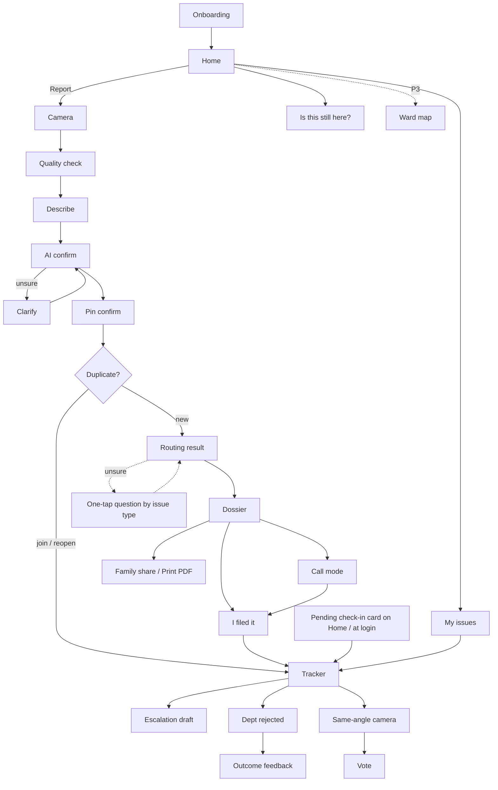

# UX: Civic Grievance Router

| | |
|---|---|
| **Source** | PRD.md v1 (confirmed 2026-10-24): all Must, S1–S5, C1–C5. Threshold 0.7, dedup 50 m, resolution 30 m |
| **Scope** | Experience only. Data rules and lifecycle live in REQUIREMENTS.md. No tech stack choices here |
| **Platform** | Mobile-first Streamlit web app, phone portrait first (360 × 640 baseline), works on desktop. Not installable, no offline mode |
| **Languages** | Hindi + English, toggle on every screen, Hindi-first option at onboarding |
| **Hand-off** | frontend-developer |
| **Updated** | 2026-10-24: TECH-MEETING-01 §4 resolutions applied (Q-1–Q-9, Q-13, Q-14, Q-16, Q-19), plus P1 nav, auth and read-aloud. **v1 is online-only.** Frontend is now **Streamlit**, see §12 *Streamlit adaptation*, which overrides earlier sections where they differ |

---

## 1. UX Principles

| # | Principle | What it means on screen |
|---|---|---|
| P1 | **Voice first** | The mic button is as big as the camera button. Typing is always optional |
| P2 | **Icon + short label** | Every action has an icon plus a 1–3 word label (Hindi and English). Never an icon alone |
| P3 | **One primary action per screen** | One full-width filled button at the bottom (thumb zone). Secondary actions are text or outline buttons |
| P4 | **Big targets** | Tap targets ≥ 48 × 48 px, primary buttons 56 px tall, 8 px minimum gap |
| P5 | **Minimal typing** | Pick from chips, confirm with Yes/No, tap the map to place the pin. Text fields are a fallback |
| P6 | **Plain language** | No "jurisdiction", "SLA", "RoW". Say "who fixes this", "deadline", "road width" |
| P7 | **Read aloud (C4)** | 🔊 button on every status and result card plays a **server-generated Hindi audio clip** of the text. It is one shared component; if the clip can't be generated, the button is hidden (never shown broken) |
| P8 | **Ask, don't guess** | Below 0.7 confidence the app asks the user. It never silently picks |
| P9 | **Never blame** | Errors explain what happened and what to do next. Never "you did it wrong" |
| P10 | **Honest limits** | "Curated data", "no rule found", "not covered yet" are said plainly, never hidden |
| P11 | **Forgiving** | Back is always safe. The draft is kept in the session while the app is open. Nothing is sent anywhere without the user doing it |

---

## 2. Information Architecture

### 2.1 Screen list

| ID | Screen | Purpose |
|---|---|---|
| S00 | Onboarding: language → privacy consent → sign in (email OTP or Google) | First run only. Permissions are asked at first use |
| S01 | Home | Big "Report a problem" + my issues + nearby |
| S02 | Capture camera | Still photo (built-in camera input) with GPS + time stamp (S1) |
| S03 | Photo quality check | Too dark / blurry → retake in better light (S2) |
| S04 | Describe | Voice note (primary) or text |
| S05 | AI confirm | "We think: Pothole, high severity — correct?" |
| S06 | Ask user / clarify | Low confidence or image–voice mismatch (C3) |
| S07 | Pin confirm | Tap the map to move the pin, plus arrow nudge buttons; landmark fallback |
| S08 | Duplicate found | "4 people already reported this — join?"; "Reopen?" for a resolved match < 30 days old; pick-from-list when the photo is low quality |
| S09 | Routing result | Department, confidence, why + citation |
| S10 | Dossier | HI+EN complaint, copy, deep link, email draft, copy-tweet |
| S11 | Filed confirmation | "I filed it" + optional reference number |
| S12 | My issues (list) | All my reports and joined issues |
| S13 | Tracker (issue detail) | Day X of Y, next step, escalation ladder |
| S14 | Escalation draft | Reminder / appeal / CPGRAMS / RTI draft (S4) |
| S15 | Dept rejected | Evidence letter or re-route (S5) |
| S16 | Outcome feedback | Accepted / bounced to X (C1) |
| S17 | Same-angle camera | Resolution re-shoot (S3): the original photo is shown above the camera (no live overlay) |
| S18 | Fixed / not fixed vote | Master-issue reporters vote |
| S19 | Ward map / scoreboard | Public, neutral (C2) |
| S20 | Settings | Language, read-aloud speed, text size, privacy, delete my data |
| S21 | One-tap question (W2) | When routing is unsure. The question depends on the issue type: road "Main road or inner lane?" · drain "Big open nala or sewer line/manhole?" · ghat "On the river bank or in the water?" |
| S22 | Call mode (PRD S6 / W3) **[P1]** | Big 📞 tel: button with the Hindi script on screen; optional 🔊 clip of the script |
| S23 | Send to family / Print (W3) | Share dossier link to helper/RWA; PDF with QR for ward office |
| S24 | Check-in nudge (PRD S7 / W4) | No push. Pending check-in cards on Home and at login for day 3 / 7 / deadline (Yes / No / Fixed); before filing, "Did you file it?" on day 1 and day 3. Optional reminder email |
| S25 | "Is this still here?" card (W4) | Passer-by confirms a nearby open issue |
| E01–E14 | Error / edge states | See §5 |

### 2.2 Navigation map

Bottom nav (icon + label): **Phase 1 has 2 tabs: Home · My issues.** The **Map** tab (S19) is added in P3. Settings sits behind the top-right ⚙. Language toggle **हि / EN** is always in the top bar.



---

## 3. Persona Journeys (experience view)

| Persona | Key moments | Design response |
|---|---|---|
| **Priya** | Wants < 60 s, types in Hinglish, wants email draft + tweet | Text field visible on S04, skip voice, "Copy all" on dossier, copy-tweet (C5), progress bar showing 5 steps |
| **Ramesh** | Can't read much, moving auto, GPS drift, MCD says "not ours" | Hindi-first, mic auto-focused, 🔊 on every card, landmark voice input ("sarkari school ke saamne"), one-tap "Dept ne mana kiya" |
| **Kamla ji** | Small text is hard, unsure of maps, wants "me too" | Text size setting (up to 200%), "Join" as the main action on S08, tracker says "Day 5 of 15" in huge type, family member can share link |

Emotional curve to protect: **frustrated (seeing problem) → relieved (we know who fixes it) → confident (I have proof) → supported (app reminds me)**.

---

## 4. User Flows

### 4.1 Report flow

```mermaid
flowchart TD
  A[Home: Report] --> B{Camera permission?}
  B -->|yes| C[Live camera: GPS+time stamped]
  B -->|no / gallery| G[Gallery pick → badge 'Location not verified']
  C --> Q{Quality check}
  G --> Q
  Q -->|dark| Q1[Move to better light / Retake] --> C
  Q -->|blurry| Q2[Hold steady / Retake] --> C
  Q -->|junk image| J[E06: Not a civic problem photo → retake]
  Q -->|ok or 'use anyway' = low quality| D[Describe: voice or text or skip]
  D --> AI[AI understanding]
  AI -->|conf ≥0.7 and no mismatch| F[AI confirm: 'Pothole, high — correct?']
  AI -->|conf <0.7| K[Ask: pick category chips]
  AI -->|photo ≠ voice C3| M[Ask: 'Photo shows streetlight, you said garbage. Which one?']
  AI -->|out of 4 categories| X[E: not supported → general channels]
  K --> F
  M --> F
  F -->|No, change| K
  F -->|Yes| L{GPS fix?}
  L -->|good| P[Pin confirm]
  L -->|low accuracy / drift| P2[Prompt: 'Location is shaky. Tap the map or tell a landmark'] --> P
  L -->|no permission| LM[Landmark: speak/type] --> P
  P --> W{Ward lookup}
  W -->|outside 20 wards| E3[E03: Not covered yet + general channels]
  W -->|boundary| E4[E04: Pick between 2 places]
  W -->|ok| PQ{Photo quality ok?}
  E4 --> PQ
  PQ -->|ok| DUP{Same category ≤50m + similar photo?}
  PQ -->|low quality| DL[Nearby same-category reports list: 'Is it one of these?']
  DL -->|picks one| DJ
  DL -->|None of these| R
  DUP -->|yes, open| DJ['N people reported this — Join?']
  DUP -->|yes, resolved < 30 days| RO['This was marked fixed on {date}. Reopen?']
  RO -->|Reopen| T
  RO -->|Mine is different| R
  DJ -->|Join| T[Tracker of master issue]
  DJ -->|Mine is different| R
  DUP -->|no| R[Routing result: dept + confidence + why + citation]
  R -->|low conf / near edge| RD[S21 one-tap question, by issue type:<br/>road: main road or inner lane?<br/>drain: big open nala or sewer/manhole?<br/>ghat: river bank or in the water?]
  RD -->|answered| R
  RD -->|Don't know| R2[Show 2 options + reason, user picks]
  R -->|no rule found| R3['कोई आधिकारिक नियम नहीं मिला' + suggested deadline 🏷]
  R --> DOS[Dossier]
  R2 --> DOS
  R3 --> DOS
  DOS -->|Priya| FILE[User files via deep link / email outside app]
  DOS -->|Ramesh| CALL[S22 Call mode: dial helpline, script read aloud]
  DOS -->|Kamla ji| SH[S23 Send to family / Print PDF]
  CALL --> I
  SH -->|helper files| I
  FILE --> I[I filed it + optional ref no.] --> T
```

Progress indicator on S02–S10: **5 dots**: Photo · Describe · Place · Department · Complaint.

**Online-only (v1):** AI, routing and dedup need the network. If it drops, the draft is kept in the session and E07 is shown. The user resumes it manually ("Continue your draft") while the app is still open; closing or refreshing the tab loses the draft. Nothing is queued or sent automatically.

**After the dossier, before "I filed it":** if the user hasn't tapped "I filed it", a "Did you file it?" card is pending on Home (and shown at login) on day 1 and day 3, with an optional reminder email: [Yes, I filed it → S11] [Not yet → back to dossier] [I won't file it]. There are no more nudges after day 3.

### 4.2 Tracker + escalation ladder (S4)

Follows REQUIREMENTS §6 exactly.
```
Filed (Day 0) ──► Day X of Y ──► Day Y+1: overdue
                                      │
                                      ├─ L0 Reminder (re-share complaint ref, 🔊 script)   ┐ both unlock
                                      └─ L1 First appeal draft → nodal / PG officer        ┘ together, no wait
                                             ▼ L1 marked filed + appeal wait elapsed
                                        L2 CPGRAMS draft (pgportal.gov.in)
                                             ▼ L2 marked filed + CPGRAMS wait elapsed
                                        L3 RTI application draft (reply due filed + 30 days)
         Next-step card always shows ONE action:
         "Wait — 10 days left"  |  "Send reminder or appeal"  |  "Prepare CPGRAMS" ...
```
Each step: preview draft → Copy / Open channel → "Done, I sent it" → ladder advances. On overdue the next-step card offers L1 as the main action, with L0 as a secondary "Just send a reminder". Later steps stay visible but locked with their unlock date ("Available on 12 Nov").

**Deadlines (W6, aligned with REQUIREMENTS FR-7.2 / §6):** every number is either cited (📄 chip) or labelled suggested. Suggested values: department deadline **15 days**, appeal wait **15 days**, CPGRAMS wait **30 days**, each with the 🏷 tag "Suggested deadline (no official rule found)". RTI reply is **30 days, cited (RTI Act s.7(1))**. Suggested counters read "Day 5 of 15 (suggested)" in `status.unverified` style, never as an official deadline.

### 4.3 Dept rejected (S5) + outcome feedback (C1)

```
Tracker → [Dept said "not ours"] →
   Q: "Which department did they send you to?" (chips: MCD · PWD · DJB · NDMC · DDA · Other · Don't know)
   ├─ Our rule says original dept is right  → Evidence letter (cites rule, doc + section) → Copy / email draft
   └─ Our rule agrees with them / unsure    → Re-route: new dept + reason → new dossier
   → Outcome card later: "Was it accepted?"  [Accepted] [Bounced again to ___]
      (feeds review flag — user sees: "Thanks, this helps us fix our data")
```

### 4.4 Resolution (S3)

```
Tracker → [Report fixed?] → Same-angle camera (original photo shown above the camera:
         "Same angle se photo lein / Take it from the same angle")
   → GPS check: (distance − GPS accuracy) ≤ 30 m?
        ├─ no  → camera disabled: "You seem ~120 m away. Move closer to the spot." [📍 Move closer] (re-checks location on tap; no "take anyway")
        └─ yes → Shoot → AI compare (advisory): "Looks fixed" / "Looks the same" / "Can't tell"
   → Vote opens for master-issue reporters: [✔ Fixed] [✘ Not fixed]
     (reporter count R is frozen when the after-photo is uploaded)
   → Rule text shown on the vote card (W5, depends on R) → "Citizen-confirmed fixed" or reopened
   → Too few votes by day 7 → keep waiting; still not decided on day 14 → "Status unknown" (never auto-"fixed")
```
AI result is always labelled "Computer's guess — people decide". **The AI is never counted as a vote.**

**Vote rule text (W5), shown on S18 under the buttons:**

| Reporters (R) | English | हिंदी |
|---|---|---|
| 1 | "You're the only reporter. Your vote with a new photo at the spot (within 30 m) decides. The computer's check only helps." | "सिर्फ़ आपने बताया है। मौके पर (30 मीटर के अंदर) नई फ़ोटो के साथ आपका वोट फ़ैसला करेगा। कंप्यूटर की जाँच सिर्फ़ मदद है।" |
| 2 | "2 people reported. It's fixed only when both of you say so." | "2 लोगों ने बताया। दोनों कहें, तभी ठीक माना जाएगा।" |
| 3+ | "{n} people reported. Most votes decide." | "{n} लोगों ने बताया। ज़्यादा वोट से फ़ैसला होगा।" |
| any | "Computer's check is not a vote. Not decided in 14 days → status unknown." | "कंप्यूटर की जाँच वोट नहीं है। 14 दिन में फ़ैसला नहीं → स्थिति पता नहीं।" |

### 4.6 Check-ins, passer-by confirm, status unknown (W4)
```
No push notifications (Streamlit). Pending check-in cards at Day 3 / Day 7 / deadline, shown on Home and
at login to every reporter on the master issue (+ optional reminder email to the user, opt-in):
  "Streetlight, Sarita Vihar: did anyone come?"  [Yes, came] [No] [✔ Fixed]
     ├─ Yes, came → "Did they fix it?" [Fixed] [Not yet]
     ├─ No        → tracker; if overdue → next ladder step card
     └─ Fixed     → S17 same-angle camera (needs after-photo) → vote
  Any reporter's answer updates the shared issue ("Updated by a reporter, 2 h ago").
Passer-by (S25): open issue within ~50 m of a user who opens the app →
  card "Is this still here?" [photo] [Still here] [Gone] [Not sure]
  "Gone" only suggests → owner reporters get a Fixed check-in; never resolves by itself.
No update for 14 days after deadline/vote → ❔ "Status unknown — help us check" (neutral grey, not red, not green).
```
Before filing (report still in dossier_ready): "Did you file it?" nudge on day 1 and day 3 only (see §4.1). It shows as a Home card and at login.
After "I filed it" the app asks once: "Can we also email you a reminder?" (off by default). The cards on Home show either way.

### 4.7 Call mode [P1], email, helper share, print (W3)
```
Dossier → [📞 Call helpline]  → S22: dept + number (e.g. PWD 1908) big, script below
             → Hindi script shown on screen, with an optional [🔊 Listen] server audio clip
             → big [📞 Call now] tel: button opens the phone dialer
             → the script stays on screen to read during the call
             → back in app: "Did you get a complaint number?" [Yes → type/speak] [No number] → S11
Dossier → [✉ Email draft] → mailto: with the **subject only** filled (dept email in "To")
             + [📋 Copy complaint text] button → user pastes the body into the email
Dossier → [👪 Send to family] → system share sheet with dossier link + 1-line Hindi message
             (link opens read-only dossier; helper can file and tap "I filed it for them")
Dossier → [🖨 Print / PDF] → A4 PDF: HI+EN complaint, photo, pin, ward, citation, deadline,
             N reporters, QR → photo evidence page. Name/phone masked unless user opts in.
```
Call mode script structure (≤ 6 lines, plain Hindi): problem + place (landmark) + since when + rule in one line + "please give complaint number".

### 4.5 Ward map / scoreboard (C2) [P3]
Map tab (added in P3) → tap ward → card: Reported · Open (median age in days) · Citizen-confirmed fixed · Status unknown. Filter by category icon. No officer names, no ranking language like "worst". Footer: "Based only on reports in this app. Curated data, 20 wards." Seeded demo data carries a **"Sample data / नमूना डेटा"** banner (W7).

---

## 5. Error & Edge States

| ID | State | User sees (EN / HI) | Action(s) |
|---|---|---|---|
| E01 | No GPS permission | "We need the place. Tell us a nearby landmark." / "जगह बताइए — पास की कोई पहचान बोलिए।" | 🎤 Speak landmark · Type · Allow location |
| E02 | GPS drift / low accuracy | "Location is shaky. Please check the pin." / "जगह पक्की नहीं है, पिन देख लीजिए।" | Tap map / arrow nudges · Use landmark |
| E03 | Outside covered wards | "We don't cover this area yet. You can still complain here:" / "यह इलाका अभी हमारे पास नहीं है। आप यहाँ शिकायत कर सकते हैं:" | List: MCD 311 / 155305 · PWD 1908 · DJB 1916 · CPGRAMS. No routing claim |
| E04 | Boundary spot | "This spot is on the edge of two areas. Which side is it?" / "यह जगह दो इलाकों की सीमा पर है। कौन-सी तरफ़?" | Two big cards with mini-map + confidence words |
| E05 | No rule found | "No official rule found. The department is our best guess." / "कोई आधिकारिक नियम नहीं मिला। विभाग हमारा अनुमान है।" | Continue. The suggested deadline is **always shown** with "Suggested deadline (no official rule found)" (dossier, tracker, drafts, readout) |
| E12 | Status unknown | "No update for a while. Is it fixed?" / "काफ़ी समय से कोई ख़बर नहीं। क्या ठीक हुआ?" | Fixed · Still there · Not sure |
| E06 | Junk image | "This photo doesn't show a road or civic problem. Please take a photo of the problem." / "इस फ़ोटो में समस्या नहीं दिख रही। समस्या की फ़ोटो लीजिए।" | Retake · Skip photo, use voice |
| E07 | Offline (v1 is online-only) | "No internet. Your draft is kept while this page stays open. Resume when you're online." / "इंटरनेट नहीं है। पेज खुला रखें, ड्राफ़्ट बचा रहेगा। नेट आने पर आगे बढ़ाइए।" | Banner. No auto-retry or queue. [Continue your draft] resumes it by hand; closing or refreshing the tab loses the draft |
| E08 | Slow network | Skeleton + "Working on it… usually 20 seconds" / "काम चल रहा है… लगभग 20 सेकंड" | Cancel after 30 s → "Try again" |
| E09 | Rate-limited | "You've sent many reports today. Please try again tomorrow." / "आज आपने कई रिपोर्ट भेजी हैं। कल फिर कोशिश करें।" | Go to My issues |
| E10 | Unsupported category | "We only handle potholes, garbage, waterlogging and streetlights for now." / "अभी हम सिर्फ़ गड्ढे, कूड़ा, जलभराव और स्ट्रीटलाइट देखते हैं।" | General channels list |
| E11 | Mic denied | "Mic is off. You can type instead, or allow mic." / "माइक बंद है। लिख दीजिए या माइक चालू कीजिए।" | Type · Allow mic |
| E13 | After-photo too far (> 30 m) | "You seem ~{d} m away. Move closer to the spot." / "आप लगभग {d} मीटर दूर हैं। मौके के पास जाइए।" | Shutter disabled · [📍 Move closer] with live distance. Photo is not accepted |
| E14 | Low-quality photo, can't compare | "The photo isn't clear enough to match. Is it one of these nearby reports?" / "फ़ोटो साफ़ नहीं है, मिलान नहीं हो पाया। क्या यह पास की इनमें से कोई रिपोर्ट है?" | List of same-category reports nearby · [None of these] |

**Loading:** never a blank spinner. Show step text ("Reading your photo… Finding the department… Finding the rule…") with a progress bar; 🔊 reads it. **Empty states:** My issues empty → illustration + "No reports yet. Saw a problem? Report it." [Report]. Map ward with no data → "No reports here yet."

---

## 6. Wireframes (low-fi, 360 px wide)

**S01 Home**
```
┌──────────────────────────────┐
│ नागरिक सहायक        हि|EN  ⚙ │
│ Namaste 🙏                     │
│ ┌──────────────────────────┐ │
│ │      📷                   │ │
│ │  समस्या बताइए             │ │  ← primary, 120px tall
│ │  Report a problem         │ │
│ └──────────────────────────┘ │
│ ┌──────────┐ ┌──────────┐    │
│ │ 🎤 बोलकर  │ │ ⌨ लिखकर  │    │  ← start with voice/text
│ └──────────┘ └──────────┘    │
│ My issues (2)                 │
│ 💡 Streetlight · Day 5 of 15 🔊│
│ 🕳 Pothole · Filed · PWD    🔊 │
│ ┌ Did you file it? (day 1/3) ┐│  ← only for unfiled dossiers
│ │ [Yes, filed] [Not yet]     ││
│ └────────────────────────────┘│
│ [   🏠 Home   ] [ 📋 My issues ]│  ← P1: 2 tabs (Map tab in P3)
└──────────────────────────────┘
```

**S00 Sign in (onboarding, after consent)**
```
┌──────────────────────────────┐
│ साइन इन करें  Sign in          │
│ So you can track your reports.│
│ [ G  Google से जारी रखें       ]│
│     Continue with Google      │
│ ─────── या / or ───────       │
│ ईमेल / Email [____________]   │
│ [ OTP भेजें  Send code ]       │  ← then 6-digit code field
│ We never show your email.     │
└──────────────────────────────┘
```

**S02 Capture**
```
┌──────────────────────────────┐
│ ←  1●○○○○                     │
│                               │
│   [ camera input preview ]    │  ← built-in still camera
│                               │
│ 📍 GPS ±8m · 24 Oct 18:42     │  ← stamp preview
│                               │
│  🖼 Gallery   [ 📷 Take photo ]│  ← built-in capture button, styled 72px
│  "Gallery photo = location    │
│   not verified"               │
└──────────────────────────────┘
```

**S05 AI confirm**
```
┌──────────────────────────────┐
│ ←  ●●○○○                hi|EN │
│ [photo thumb]                 │
│ हमें लगता है / We think:      │
│ ┌──────────────────────────┐ │
│ │ 🕳 गड्ढा  Pothole          │ │
│ │ 🔴 ज़्यादा ख़तरा  High      │ │
│ │ "Pretty sure" ●●●●○  🔊   │ │
│ └──────────────────────────┘ │
│ You said: "Bada gaddha hai…" │
│ [ ✔ हाँ, सही है  Yes ]        │  ← primary
│ [ ✎ बदलें  Change ]           │
└──────────────────────────────┘
```

**S06 Clarify (conf < 0.7 or mismatch)**
```
│ फ़ोटो में स्ट्रीटलाइट है, आपने कूड़ा कहा। │
│ Photo shows streetlight, you said garbage.  │
│ Which one is it?                            │
│ [💡 Streetlight] [🗑 Garbage]               │
│ [🕳 Pothole]     [🌊 Waterlogging]          │
│ [ None of these ]                           │
```

**S07 Pin confirm**
```
┌──────────────────────────────┐
│ ←  ●●●○○                      │
│ क्या जगह सही है? Is this the place? │
│ ┌──────────────────────────┐ │
│ │       [ map ]            │ │
│ │   📍 (tap map to move)   │ │
│ └──────────────────────────┘ │
│      [⬆]                      │  ← arrow nudges, ~5 m per tap
│ [⬅]  [⬇]  [➡]                 │
│ Near: Govt School, Sarita Vihar│
│ ⚠ Location shaky — check pin  │  (drift only)
│ [🎤 Tell a landmark]          │
│ [ ✔ हाँ, यही जगह  Yes, here ] │
└──────────────────────────────┘
```

**S08 Duplicate join**
```
┌──────────────────────────────┐
│ [their photo] [your photo]    │
│ 👥 4 लोग पहले ही बता चुके हैं  │
│ 4 people already reported this│
│ 30 m away · Garbage · Day 3   │
│ Joining makes it stronger 💪  │
│ [ 🤝 मैं भी  Join (me too) ]   │  ← primary
│ [ Mine is a different problem ]│
└──────────────────────────────┘
```

**S08b Reopen (match is resolved, < 30 days old)**
```
┌──────────────────────────────┐
│ [fixed photo] [your photo]    │
│ ✔ 12 Oct को ठीक बताया गया था    │
│ Marked fixed on 12 Oct        │
│ फिर से खोलें? Reopen?           │
│ [ 🔁 फिर से खोलें  Reopen ]     │  ← primary
│ [ Mine is a different problem ]│
└──────────────────────────────┘
```

**S08c Low-quality photo → pick from nearby (Q-14)**
```
┌──────────────────────────────┐
│ फ़ोटो साफ़ नहीं है।              │
│ Photo isn't clear enough to   │
│ match. Is it one of these?    │
│ ┌ [photo] 🌊 · 20 m · Day 4 ┐│
│ │ 3 people · [Yes, this one]││
│ └───────────────────────────┘│
│ ┌ [photo] 🌊 · 45 m · Day 9 ┐│
│ │ 1 person · [Yes, this one]││
│ └───────────────────────────┘│
│ [ इनमें से कोई नहीं  None of these ]│
└──────────────────────────────┘
```

**S09 Routing result**
```
┌──────────────────────────────┐
│ ←  ●●●●○                      │
│ इसे कौन ठीक करेगा? Who fixes this?│
│ ┌──────────────────────────┐ │
│ │ 🏛 PWD (Delhi Govt)        │ │
│ │ Sure: ●●●●○ "Very likely" │ │
│ │ Deadline: 7 days 📄        │ │  ← no rule: "15 days 🏷 suggested"
│ └──────────────────────────┘ │
│ Why? / क्यों?                   │
│ Road is 60 ft+ wide. Such roads│
│ are PWD's since 2012.          │
│ 📄 PWD Circular 2025, para 2 › │  ← opens excerpt
│ 🏷 Curated data · verified Oct │
│ [ शिकायत बनाएँ  Make complaint ]│
└──────────────────────────────┘
```
Low confidence variant: S21 first; if "Don't know", two cards "Most likely PWD" / "Maybe MCD" with reason, user taps one.
No-rule variant: the department card shows "🏷 कोई आधिकारिक नियम नहीं मिला / No official rule found" and the deadline line reads "Suggested deadline: 15 days (no official rule found)". The deadline is never hidden.

**S21 One-tap question (W2).** Same layout for all three; the question matches the issue type. Picture tiles are 140 px, and "Don't know" is always offered.

S21a, road (pothole, streetlight on a road): decides PWD or MCD
```
┌──────────────────────────────┐
│ ←  ●●●●○                      │
│ मेन रोड या अंदर की गली?    🔊 │
│ Main road or inner lane?      │
│ ┌────────────┐ ┌────────────┐│
│ │ 🛣 (wide,   │ │ 🏘 (narrow, ││  ← picture tiles, 140px
│ │ many lanes)│ │ houses)    ││
│ │ मेन रोड     │ │ अंदर की गली ││
│ │ Main road  │ │ Inner lane ││
│ └────────────┘ └────────────┘│
│ [ पता नहीं  Don't know ]       │
│ This decides PWD or MCD.      │
└──────────────────────────────┘
```

S21b, drain (waterlogging/sewage): decides DJB (sewer) or PWD/MCD (open drain)
```
┌──────────────────────────────┐
│ ←  ●●●●○                      │
│ बड़ा खुला नाला या सीवर/मैनहोल? 🔊│
│ Big open nala or sewer        │
│ line/manhole?                 │
│ ┌────────────┐ ┌────────────┐│
│ │ 🌊 (wide    │ │ ⭘ (round   ││
│ │ open drain)│ │ manhole lid)││
│ │ खुला नाला   │ │ सीवर/मैनहोल ││
│ │ Open nala  │ │ Sewer/     ││
│ │            │ │ manhole    ││
│ └────────────┘ └────────────┘│
│ [ पता नहीं  Don't know ]       │
│ This decides who cleans it.   │
└──────────────────────────────┘
```

S21c, ghat (e.g. Kalindi Kunj): decides the river-bank agency vs the river/water agency
```
┌──────────────────────────────┐
│ ←  ●●●●○                      │
│ नदी किनारे या पानी में?      🔊 │
│ On the river bank or in the   │
│ water?                        │
│ ┌────────────┐ ┌────────────┐│
│ │ 🏞 (steps,  │ │ 🌊 (floating││
│ │ bank)      │ │ in river)  ││
│ │ नदी किनारे  │ │ पानी में    ││
│ │ River bank │ │ In the water││
│ └────────────┘ └────────────┘│
│ [ पता नहीं  Don't know ]       │
│ This decides who cleans it.   │
└──────────────────────────────┘
```

**S10 Dossier**
```
┌──────────────────────────────┐
│ ←  ●●●●●  Your complaint      │
│ [हिंदी] [English]   (tabs)  🔊 │
│ ┌──────────────────────────┐ │
│ │ सेवा में, PWD…              │ │
│ │ (complaint text, editable)│ │
│ └──────────────────────────┘ │
│ 📷 photo · 📍 pin · 📄 rule ·  │
│ ⏱ 7 days · 👥 4 citizens       │  ← no rule: "⏱ 15 days 🏷 suggested"
│ [📞 फ़ोन करें Call helpline]    │  ← primary if Hindi-first / voice user
│ [📋 Copy complaint text]       │
│ [✉ Email draft] (subject only) │  ← then paste the copied text
│ [🐦 Copy tweet] [👪 Send family]│
│ [🖨 Print / PDF with QR]       │
│ We don't send this. You file. │
│ [ ↗ PWD 1908 पर दर्ज करें     ]│  ← primary deep link (others)
│ [ मैंने दर्ज कर दी  I filed it ]│
└──────────────────────────────┘
```
Only one primary: Call helpline for users who chose Hindi-first or used voice; deep link otherwise. Email draft opens `mailto:` with only the subject filled (long Hindi bodies break mail links); a hint under it says "Paste the complaint text into the email" / "शिकायत का टेक्स्ट ईमेल में पेस्ट करें".

**S22 Call mode [P1]**: a big tel: button with the script on screen. The 🔊 clip is optional and is not needed before calling.
```
┌──────────────────────────────┐
│ ← फ़ोन पर शिकायत  Call mode    │
│ 🏛 PWD helpline               │
│        1908                   │  ← 40px
│ ┌ बोलने के लिए / Say this ───┐│
│ │ नमस्ते, मुझे शिकायत करनी है।  ││
│ │ सरकारी स्कूल के सामने, सरिता ││
│ │ विहार में बड़ा गड्ढा है।       ││
│ │ यह 60 फ़ुट रोड PWD की है।    ││
│ │ कृपया शिकायत नंबर दीजिए।     ││
│ └───────────────────────────┘│
│ [🔊 सुनें  Listen]             │  ← server audio clip (optional)
│ [ 📞 अभी फ़ोन करें  Call now ] │  ← big tel: link button, 56px+
│ Keep this screen open to read │
│ during the call.              │
└──────────────────────────────┘
```

**S23 Send to family / Print**
```
│ 👪 परिवार को भेजें  Send to family         │
│ They can file it for you.                   │
│ [ WhatsApp / SMS / … (system share) ]       │
│ 🖨 प्रिंट / PDF  Print / PDF                │
│ Take it to the ward office. QR shows photo. │
│ [☐ Add my name and phone] (off by default)  │
│ [ ⬇ PDF डाउनलोड करें  Download PDF ]        │
```

**S13 Tracker**
```
┌──────────────────────────────┐
│ ← 💡 Streetlight · MCD     🔊 │
│      दिन 5 / 15               │  ← 40px
│      Day 5 of 15              │
│ ▓▓▓▓▓░░░░░░░░░░               │
│ 🏷 Suggested deadline (no     │  ← only when not cited
│    official rule found)       │
│ Updated by a reporter, 2h ago │
│ ┌ Next step ────────────────┐│
│ │ Wait. 10 days left.       ││
│ │ We'll remind you on 3 Nov ││
│ └───────────────────────────┘│
│ Ladder:                       │
│ ✔ Filed (ref 12345)           │
│ ○ Reminder + Appeal · 8 Nov   │  ← L0 + L1 unlock together
│ 🔒 CPGRAMS   🔒 RTI            │
│ [Dept said "not ours"]        │
│ [Report fixed? 📷]            │
└──────────────────────────────┘
```

**S17 Same-angle camera** (no live overlay: the Streamlit camera takes still photos only)
```
┌──────────────────────────────┐
│ ←  Match the old photo        │
│ ┌ Original photo ──────────┐ │
│ │ [old photo, full opacity] │ │
│ └──────────────────────────┘ │
│ Same angle se photo lein      │
│ Take it from the same angle   │
│ ┌──────────────────────────┐ │
│ │ [ camera input preview ]  │ │
│ └──────────────────────────┘ │
│ 📍 18 m from original ✔       │
│      [ 📷 Take photo ]        │
└──────────────────────────────┘
```
Too far (> 30 m after GPS accuracy is allowed for): the camera input is disabled, and the bar reads "📍 ~120 m away. Move closer / मौके के पास जाइए" (icon + text, not color alone), with a [📍 Move closer] button that re-checks the location and shows a mini-map of the spot. There is no "take anyway".

**S18 Vote**
```
│ [before] → [after]                       │
│ Computer's guess: "Looks fixed" (not a vote)    │
│ क्या यह ठीक हो गया? Is it fixed?             │
│ [ ✔ ठीक हुआ Fixed ]  [ ✘ नहीं हुआ Not fixed ] │
│ 2 of 4 reporters voted                   │
│ ⓘ {vote rule text for reporter count, §4.4} │
```

**S24 Check-in card (pending on Home + at login; no push)**
```
┌──────────────────────────────┐
│ 🔔 जवाब बाकी / Pending · Day 7  │
│ 💡 स्ट्रीटलाइट, सरिता विहार       │
│ क्या कोई आया? Did anyone come? │
│ [हाँ Yes] [नहीं No] [✔ ठीक Fixed]│
└──────────────────────────────┘
```

**S25 Passer-by card (Home, issue nearby)**
```
│ 📍 पास में / Nearby · 🕳 Pothole · Day 12   │
│ [photo]                                     │
│ क्या यह अभी भी है? Is this still here?      │
│ [ अभी भी है Still here ] [ हट गया Gone ]    │
│ [ पता नहीं Not sure ]                        │
```

**S19 Ward map [P3]**
```
┌──────────────────────────────┐
│ Filter: [All][🕳][🗑][🌊][💡]  │
│ [ map with ward outlines,     │
│   neutral grey shading ]      │
│ ┌ Sarita Vihar (curated) ───┐│
│ │ Reported 42 · Open 18     ││
│ │ Open for (median) 9 days  ││
│ │ Citizen-confirmed fixed 20││
│ └───────────────────────────┘│
│ Only data from this app. No   │
│ officer names.                │
└──────────────────────────────┘
```

---

## 7. Microcopy

### 7.1 Tone guide
- Use **"aap"** (आप), never "tum". Polite imperatives: "लीजिए", "बताइए".
- Simple spoken Hindi, not Sanskritised (जगह not स्थान, शिकायत ok). Hinglish words fine where common (फ़ोटो, पिन, लाइट).
- Max ~12 words per sentence, one idea per sentence.
- Never blame: "photo is dark" not "you took a bad photo".
- Empathise once, then act: "That sounds unsafe. Let's get it to the right people."
- Be honest about limits: "our guess", "curated data", "we don't send this".

### 7.2 Key strings

| Key | English | हिंदी |
|---|---|---|
| report | Report a problem | समस्या बताइए |
| speak | Speak | बोलकर बताइए |
| type | Type | लिखकर बताइए |
| retake | Retake photo | फिर से फ़ोटो लें |
| too_dark | Photo is too dark. Move to better light and retake. | फ़ोटो बहुत अंधेरी है। रोशनी में जाकर फिर से लें। |
| blurry | Photo is blurry. Hold the phone steady. | फ़ोटो धुंधली है। फ़ोन स्थिर रखें। |
| use_anyway | Use anyway | फिर भी इस्तेमाल करें |
| unverified | Location not verified (gallery photo) | जगह पक्की नहीं (गैलरी फ़ोटो) |
| we_think | We think: {category}, {severity}. Correct? | हमें लगता है: {category}, {severity}। सही है? |
| yes_right | Yes, correct | हाँ, सही है |
| change | Change | बदलें |
| is_place | Is this the place? | क्या यह सही जगह है? |
| landmark | Tell a nearby landmark | पास की कोई पहचान बताइए |
| dup | {n} people already reported this. Join? | {n} लोग पहले ही यह बता चुके हैं। जुड़ें? |
| join | Me too | मैं भी |
| who_fixes | Who fixes this? | इसे कौन ठीक करेगा? |
| why | Why? | क्यों? |
| make_complaint | Make my complaint | शिकायत बनाएँ |
| we_dont_send | We don't send this. You file it. | हम इसे नहीं भेजते। आप दर्ज करें। |
| copy | Copy | कॉपी करें |
| filed | I filed it | मैंने दर्ज कर दी |
| ref_no | Reference number (optional) | शिकायत नंबर (ज़रूरी नहीं) |
| day_x | Day {x} of {y} | दिन {x} / {y} |
| rejected | Department said "not ours" | विभाग ने मना कर दिया |
| fixed_q | Is it fixed? | क्या यह ठीक हो गया? |
| fixed / not_fixed | Fixed / Not fixed | ठीक हुआ / नहीं हुआ |
| empathy_light | A dark street is unsafe. Let's get it fixed. | अंधेरी गली ख़तरनाक है। चलिए इसे ठीक करवाते हैं। |
| thanks | Thank you. Your voice matters. | धन्यवाद। आपकी आवाज़ मायने रखती है। |
| ai_guess | Computer's guess — people decide | कंप्यूटर का अनुमान — फ़ैसला लोगों का |
| road_q | Main road or inner lane? | मेन रोड या अंदर की गली? |
| main_road / inner_lane / dont_know | Main road / Inner lane / Don't know | मेन रोड / अंदर की गली / पता नहीं |
| drain_q | Big open nala or sewer line/manhole? | बड़ा खुला नाला या सीवर/मैनहोल? |
| open_nala / sewer_manhole | Open nala / Sewer or manhole | खुला नाला / सीवर या मैनहोल |
| ghat_q | On the river bank or in the water? | नदी किनारे या पानी में? |
| river_bank / in_water | River bank / In the water | नदी किनारे / पानी में |
| q_decides | This decides who fixes it. | इससे तय होगा कि कौन ठीक करेगा। |
| call | Call helpline | फ़ोन करें |
| call_now | Call now | अभी फ़ोन करें |
| say_this | Say this on the call | फ़ोन पर यह बोलिए |
| listen | Listen | सुनें |
| listen_again | Listen again | फिर सुनें |
| keep_open | Keep this screen open to read during the call. | फ़ोन के दौरान पढ़ने के लिए यह स्क्रीन खुली रखें। |
| copy_text | Copy complaint text | शिकायत का टेक्स्ट कॉपी करें |
| email_draft | Email draft | ईमेल ड्राफ़्ट |
| paste_hint | Paste the complaint text into the email | शिकायत का टेक्स्ट ईमेल में पेस्ट करें |
| did_file | Did you file it? | क्या आपने शिकायत दर्ज की? |
| did_file_a | Yes, I filed it / Not yet / I won't file it | हाँ, दर्ज कर दी / अभी नहीं / दर्ज नहीं करूँगा/करूँगी |
| reopen_q | This was marked fixed on {date}. Reopen? | इसे {date} को ठीक बताया गया था। फिर से खोलें? |
| reopen | Reopen | फिर से खोलें |
| pick_nearby | The photo isn't clear enough to match. Is it one of these? | फ़ोटो साफ़ नहीं है, मिलान नहीं हो पाया। क्या यह इनमें से कोई है? |
| this_one / none | Yes, this one / None of these | हाँ, यही है / इनमें से कोई नहीं |
| move_closer | You seem ~{d} m away. Move closer to the spot. | आप लगभग {d} मीटर दूर हैं। मौके के पास जाइए। |
| move_closer_btn | Move closer | पास जाइए |
| draft_saved | No internet. Your draft is kept while this page stays open. Resume when you're online. | इंटरनेट नहीं है। पेज खुला रखें, ड्राफ़्ट बचा रहेगा। नेट आने पर आगे बढ़ाइए। |
| same_angle | Take it from the same angle | Same angle se photo lein |
| email_remind | Can we also email you a reminder? | क्या हम आपको ईमेल से भी याद दिलाएँ? |
| resume | Continue your draft | अपना ड्राफ़्ट आगे बढ़ाइए |
| sign_in | Sign in | साइन इन करें |
| google | Continue with Google | Google से जारी रखें |
| email_otp | Send code to email | ईमेल पर कोड भेजें |
| enter_code | Enter the 6-digit code | 6 अंकों का कोड डालें |
| no_rule | No official rule found | कोई आधिकारिक नियम नहीं मिला |
| not_a_vote | The computer's check is not a vote | कंप्यूटर की जाँच वोट नहीं है |
| got_number | Did you get a complaint number? | क्या शिकायत नंबर मिला? |
| send_family | Send to family | परिवार को भेजें |
| family_msg | Please file this complaint for me: {link} | कृपया मेरी यह शिकायत दर्ज कर दीजिए: {link} |
| filed_for | I filed it for them | मैंने उनकी तरफ़ से दर्ज कर दी |
| print | Print / download PDF | प्रिंट / PDF डाउनलोड करें |
| print_hint | Take it to the ward office. The QR shows the photo. | इसे वार्ड ऑफ़िस ले जाइए। QR से फ़ोटो दिखेगी। |
| checkin | Did anyone come? | क्या कोई आया? |
| still_here | Is this still here? | क्या यह अभी भी है? |
| still_here_a / gone / not_sure | Still here / Gone / Not sure | अभी भी है / हट गया / पता नहीं |
| updated_by | Updated by a reporter, {time} ago | एक रिपोर्टर ने {time} पहले बताया |
| status_unknown | Status unknown — help us check | स्थिति पता नहीं — जाँचने में मदद करें |
| suggested_dl | Suggested deadline (no official rule found) | सुझाई गई समय-सीमा (कोई आधिकारिक नियम नहीं मिला) |
| default_dl | Day {x} of {y} (suggested) | दिन {x} / {y} (सुझाई गई) |
| remind_q | Can we remind you on Day 3? | क्या हम दिन 3 पर आपको याद दिलाएँ? |

The Hindi for "no official rule" is always **कोई आधिकारिक नियम नहीं मिला**. Never use "सरकारी नियम".
| sample | Sample data | नमूना डेटा |

Category labels: गड्ढा Pothole · कूड़े का ढेर Garbage dump · जलभराव / सीवर Waterlogging/sewage · ख़राब स्ट्रीटलाइट Broken streetlight.

---

## 8. Visual Design Tokens

Direction: **civic, calm, trustworthy**. Deep blue primary (govt-adjacent but not imitating any official logo), warm neutral background, generous spacing, no decorative clutter.

### 8.1 Color (contrast ratios vs. respective background)

| Token | Light | Dark | Use / contrast |
|---|---|---|---|
| `color.bg` | #FAFAF7 | #121417 | page |
| `color.surface` | #FFFFFF | #1E2126 | cards |
| `color.text` | #1A1A1A | #EDEFF2 | body, ≥ 15:1 / 14:1 |
| `color.text-muted` | #4A4F57 | #B4BAC3 | secondary, ≥ 7:1 / 8:1 |
| `color.primary` | #0B5CAD | #7DB4F0 | buttons/links, 6.6:1 / 8.5:1 |
| `color.on-primary` | #FFFFFF | #0A1A2E | text on primary |
| `color.border` | #8A9099 | #5C636D | inputs, 3:1 non-text |
| `color.focus` | #F2A900 ring 3px | #FFD166 | focus outline |
| `status.open` | #8A5A00 / bg #FFF4D6 | #FFC85C / bg #3A2E10 | Open / waiting |
| `status.overdue` | #B3261E / bg #FDE7E5 | #FF8A80 / bg #3B1715 | Deadline passed |
| `status.fixed` | #1E7B34 / bg #E3F4E7 | #7BD88F / bg #12301A | Citizen-confirmed fixed |
| `status.info` | #0B5CAD / bg #E6F0FA | #7DB4F0 / bg #13263D | Filed / in progress |
| `status.unverified` | #5B4B8A / bg #EEEAF7 | #B9A8F0 / bg #241D3A | Gallery / curated / suggested-deadline badges |
| `status.unknown` | #4A4F57 / bg #EDEEF0 | #B4BAC3 / bg #2A2E34 | Status unknown (neutral) |

All status text colors ≥ 4.5:1 on their bg. Status is **always icon + word + color** (⏳ Open, ⚠ Overdue, ✔ Fixed, 📨 Filed, ❔ Unknown).

### 8.2 Typography
Font: a system/Noto-family face with full Devanagari support (both scripts same visual weight). Hindi line-height ≥ 1.6 (matras need room).

| Token | Size / line-height | Use |
|---|---|---|
| `type.display` | 40 / 48 | "Day 5 of 15" |
| `type.h1` | 28 / 36 | Screen title |
| `type.h2` | 22 / 30 | Card title |
| `type.body` | 18 / 28 | Default body (not 16 — elderly users) |
| `type.label` | 18 / 24, weight 600 | Buttons |
| `type.small` | 16 / 24 | Minimum allowed size |

Text-size setting: 100 / 130 / 160 / 200%. Layout must reflow, never truncate.

### 8.3 Spacing, shape, motion
- Spacing scale (px): `4 · 8 · 12 · 16 · 24 · 32 · 48`. Screen padding 16, card padding 16–24.
- Radius: `8` inputs, `12` cards, `999` chips. Elevation: one level shadow for cards only.
- Targets: `size.tap-min 48`, `size.button 56`, `size.shutter 72`, `size.mic 72`.
- Motion ≤ 200 ms, respects reduce-motion. No auto-moving carousels.

### 8.4 Iconography
Simple filled line icons, 32 px in cards, 24 px in nav, always with a label.

| Category | Icon | Color accent |
|---|---|---|
| Pothole | road with hole 🕳 | brown #7A4B1E |
| Garbage dump | bin/heap 🗑 | olive #5E6B1F |
| Waterlogging/sewage | water waves 🌊 | teal #0E6E7A |
| Broken streetlight | lamp post 💡 | amber #8A5A00 |

Accent colors identify category but never replace the icon + label. Other icons: 📍 pin, 🎤 mic, 🔊 read aloud, 📄 citation, 🏷 curated, 👥 reporters, ⏱ deadline.

### 8.5 Component list
Top bar (back, title, हि/EN, ⚙) · Bottom nav (P1: 2 tabs Home · My issues; P3 adds Map) · Sign-in card (Google button + email OTP) · Primary button · Secondary button · Big tile button (home) · Built-in voice record button (+ re-record) · Built-in still camera with stamp preview · Original-photo-above-camera block · Quality warning sheet · Category chip grid · Confidence meter (dots + words) · Map pin picker · Landmark input (voice/text) · Duplicate comparison card · Department card · Citation chip → excerpt sheet · Curated badge · Unverified badge · Dossier text tabs (HI/EN) · Copy button with "Copied ✔" toast · Progress dots · Day X of Y counter + bar · Escalation ladder (stepper) · Next-step card · Vote buttons · Ward stat card · Picture choice tiles (one-tap question; content set by issue type: road / drain / ghat) · Call-mode script card (auto-play → Call now) · Copy complaint text button · Share/print sheet · Check-in card (Yes/No/Fixed) · "Did you file it?" card · Reopen card · Nearby-reports pick list · Distance bar with Move closer · Passer-by card · Vote rule note · Banner (offline/draft saved/info) · Skeleton loader with step text · Empty state · Bottom sheet · Toast · **Read-aloud button: one shared component, used everywhere; it plays a server-generated Hindi audio clip and renders nothing if the clip is unavailable.**

---

## 9. Confidence, Trust & Privacy UX

### 9.1 Confidence display (no raw numbers by default)
| Score | Dots | Words (EN / HI) | Behaviour |
|---|---|---|---|
| ≥ 0.9 | ●●●●● | Very sure / पूरा भरोसा | Normal flow |
| 0.7–0.89 | ●●●●○ | Pretty sure / काफ़ी भरोसा | Normal flow |
| 0.5–0.69 | ●●○○○ | Not sure — please check / पक्का नहीं — देख लीजिए | Ask user, show options |
| < 0.5 | ●○○○○ | We don't know / हमें नहीं पता | Ask user, show options |

Exact number appears on tap of "Details" (for Priya / portfolio demo).

### 9.2 Trust signals
- Every department and deadline has a 📄 citation chip; tap → bottom sheet with doc name, section, quoted excerpt, "last verified" date.
- 🏷 **"Curated data"** badge on routing + map: tap → "Our team built this list by hand for 20 Delhi wards. It can be wrong. Tell us if it is."
- "We don't send anything to the government. You file it." shown on dossier and onboarding.
- AI-compare result always "Computer's guess — people decide".

### 9.3 What is shown to whom
| Data | Me | Other reporters of same issue | Public map | Dossier (outbound) |
|---|---|---|---|---|
| My name / phone | ✔ | ✘ | ✘ | Masked unless I choose to add it |
| My photo | ✔ | ✔ (on join/vote) | ✘ | ✔ |
| Exact pin | ✔ | ✔ | Ward-level counts only | ✔ |
| Voice note audio | ✔ | ✘ | ✘ | Transcript only |
| Report count | ✔ | ✔ | ✔ | ✔ |

### 9.4 Onboarding consent (S00)
3 short cards, each with 🔊, then one checkbox (unticked by default) + "Start":
1. "We help you find who fixes the problem and write the complaint. **You** send it."
2. "We use your photo, voice and location **only** for this complaint. Your name and number are never public."
3. "Some data is hand-made by us and may be wrong. We always show the source."
Location/camera/mic permissions are asked **at first use** with a one-line reason, not all at start. Settings has "Delete my data".

---

## 10. Accessibility Checklist (WCAG 2.1 AA)

- [ ] Text contrast ≥ 4.5:1, large text and UI borders ≥ 3:1, in light and dark (tokens §8.1)
- [ ] No color-only meaning: status = icon + word + color; map uses pattern/labels, not just shading
- [ ] Tap targets ≥ 48 px, spacing ≥ 8 px; primary actions in bottom thumb zone
- [ ] Text resize to 200% without loss/overlap; respects system font size
- [ ] Every icon button has an accessible name in the current language (e.g. "फ़ोटो लें / Take photo")
- [ ] Screen reader order = visual order; one H1 per screen; live region announces loading steps and errors
- [ ] `lang` attribute set per string block (hi / en) so screen readers switch voice
- [ ] Hindi TTS read-aloud (C4) on status cards, routing result, errors; server-generated audio clip with the player's own play/stop controls. Hidden (not disabled) if the clip can't be generated; text is always on screen
- [ ] Voice input always paired with a text alternative and vice versa
- [ ] Visible focus ring (3 px) for keyboard / switch users
- [ ] Map pin can be adjusted without dragging: "move pin" arrow buttons + landmark input
- [ ] Camera shutter and mic usable one-handed (72 px, bottom thumb zone)
- [ ] No time limits on any step; the draft is kept in the session
- [ ] Reduce-motion respected; no flashing content
- [ ] Error messages state cause + fix, announced to assistive tech
- [ ] Forms: labels always visible (no placeholder-only labels)
- [ ] Works on low-end Android: light pages, images compressed, usable on slow 3G

---

## 11. Usability Test Plan

**Setup:** 3 participants per persona type (9 total if possible, minimum 1 per persona), think-aloud, own phone where possible, moderator in Hindi or English. Prototype with mock AI responses so each branch can be forced.

| # | Task | Persona focus | Forced branch | Success criteria |
|---|---|---|---|---|
| T1 | "Report the pothole in this photo using your voice, then complain by phone." | Ramesh | GPS drift → landmark → road-type question → Call mode | Reaches dossier without typing; answers main road/lane; follows the read-aloud script; < 3 min |
| T2 | "A neighbour already reported this streetlight. Add yourself, then send it to your son." | Kamla ji | Duplicate → Send to family; Day-3 check-in | Taps "Me too" unaided; shares to family; answers check-in in one tap; can say what "Day 5 of 15" means |
| T3 | "Get the complaint ready and send it to the right department by email." | Priya | High confidence, citation | < 60 s capture → dossier; can explain *why* PWD (reads citation) |
| T4 | "It's been 20 days and nothing happened. What do you do now?" | All | Overdue tracker | Finds next-step card, opens appeal draft, understands app doesn't send it |
| T5 | "The department said it's not their job. Then later it got fixed — tell the app." | Ramesh, Kamla ji | Dept rejected → same-angle camera → vote | Generates evidence letter; retakes from the same angle within 30 m; votes |

**Measure:** task success (unaided / with hint / fail), time on task, errors, number of times 🔊 used, SEQ (1–7, Hindi smiley scale for low-literacy), and one question: "Who will send this complaint?" (correct answer: "I will" — checks the no-auto-submit message landed).

**Watch for:** confusion between "I filed it" and "Make complaint"; reading of confidence dots; whether the unverified badge scares users off gallery photos; Hindi wording that sounds too formal.

---

## 12. Streamlit adaptation

The frontend is **Streamlit**, not a React PWA. Where this section differs from earlier ones, this section wins (the flows and wireframes above are already updated to match).

| # | PWA idea | Streamlit version |
|---|---|---|
| 1 | Ghost-overlay camera (S17) | Not possible, because the built-in camera input takes still photos only. Show the **original photo above the camera** with the hint "Same angle se photo lein / Take it from the same angle". The 30 m check and "Move closer" stay |
| 2 | Push nudges (S7 / S24, day-1/3 "Did you file it?") | **No push.** Nudges are **pending check-in cards** on Home and shown at login (oldest first, one tap to answer), plus an **optional reminder email** to the user (opt-in, off by default) |
| 3 | Drag the pin (S07) | **Tap/click the map** to place the pin, plus **⬆⬇⬅➡ nudge buttons** (~5 m per tap) and the landmark fallback |
| 4 | Custom mic + waveform (S04) | The **built-in audio record button** (record → playback → re-record). Typing is still offered next to it |
| 5 | Device TTS read-aloud | The 🔊 component plays a **server-generated Hindi audio clip**. It is hidden if the clip can't be made |
| 6 | Call mode with script auto-play (S22) | A **big tel: link button** ("📞 Call now", ≥ 56 px) with the Hindi script on screen; the 🔊 clip is optional |
| 7 | SPA screens | **One screen per Streamlit page/step** (S-IDs map 1:1 to pages or step states). Nav = 2 big buttons (Home · My issues). Inject CSS from §8 tokens: 56 px full-width primary buttons, 48 px minimum targets, 18 px body, 3 px focus ring, §8.1 colors |
| 8 | Installable PWA, offline queue | **Not installable, no offline mode.** The draft lives in **session state** only; E07 says the draft is kept while the page stays open, and a refresh loses it |

Also: the camera input has no flash control, so the "too dark" copy says "move to better light and retake". The text-size setting (§8.2) is applied with the same injected CSS (root font scale).

---

## Handoff → frontend-developer
- Build from §2 screen list, §6 wireframes, §8 tokens/components; strings from §7.2 (keep keys).
- All thresholds (0.7, 50 m, 30 m) come from REQUIREMENTS.md config — don't hard-code in UI copy except via placeholders.
- Prototype with mocked AI responses first so §11 tests can force every branch.
- Escalation timing follows REQUIREMENTS §6 (L0 + L1 unlock together at overdue). v1 is online-only: drafts are saved locally and resumed by hand, with no offline queue.
- Phase 1 includes S22 Call mode and a 2-tab nav. Map (S19) is P3.
- Build in **Streamlit** following §12: one page/step per screen, big-button CSS from the §8 tokens, draft kept in session state.
- Open question: whether reference-number entry should support a photo of the receipt (deferred).

---

## 13. Look & feel reference (user, 2026-10-24): overrides colour/layout details above where they conflict

**Direction:** minimal but polished, modelled on a modern desktop-chat app look (the user's reference screenshot): calm dark surfaces, a left sidebar, a centred content column, soft rounded cards, thin borders, generous spacing. "People judge a book by its cover", so it must look finished, never like a default Streamlit page.

```
┌──────────────┬──────────────────────────────────────────────────────┐
│  Sidebar     │                                                      │
│  ─────────   │        ┌────────────────────────────────────┐        │
│  + New report│        │  Card: step title                  │        │
│  My issues   │        │  short helper text (muted)         │        │
│  Map (P3)    │        │  [ big primary button ]            │        │
│              │        └────────────────────────────────────┘        │
│  हि / EN     │        ┌────────────────────────────────────┐        │
│  Text size   │        │  Card: tracker "Day 9 of 15"       │        │
│  ─────────   │        └────────────────────────────────────┘        │
│  user · out  │          centred column, max-width 760 px            │
└──────────────┴──────────────────────────────────────────────────────┘
```

| Token | Dark (default) | Light |
|---|---|---|
| Page background | `#262624` | `#FAF9F5` |
| Sidebar | `#1F1E1D` | `#F0EEE6` |
| Card | `#30302E` | `#FFFFFF` |
| Border (1 px) | `#3E3E3A` | `#E5E3DA` |
| Text | `#ECEAE4` | `#1F1E1D` |
| Muted text | `#A3A19A` | `#6B6962` |
| Accent (one only: buttons, links, focus) | `#5B9CF5` | `#2563C9` |
| Status | success `#4CAF7A` · warning `#E0A43A` · danger `#E06C5A`, always with an icon + word |

**Rules**
- Cards: 12 px radius, 1 px border, 20–24 px padding, no shadows or gradients.
- Type: one clean sans (Inter / Noto Sans Devanagari for Hindi), body 17–18 px, headings 22 / 18 px weight 500, line-height 1.6.
- One primary button per screen (accent fill, ≥ 48 px tall, rounded 10 px); secondary buttons are outlined.
- Muted helper text under each title; icons as simple line icons; small pill badges for status ("Curated data", "Suggested deadline").
- Bottom-of-screen info bars like the reference's banner style for notices (e.g. "Location may be off").
- Accessibility stays: AA contrast on both themes, the 100/150/200 % text-size setting, Hindi labels.

**Streamlit implementation:** `ui/.streamlit/config.toml` `[theme] base="dark"` with the colours above + `ui/style.css` (cards, buttons, sidebar spacing, hide the default Streamlit header/footer), injected once via `st.markdown`. Sidebar = `st.sidebar` navigation. No extra UI libraries.
