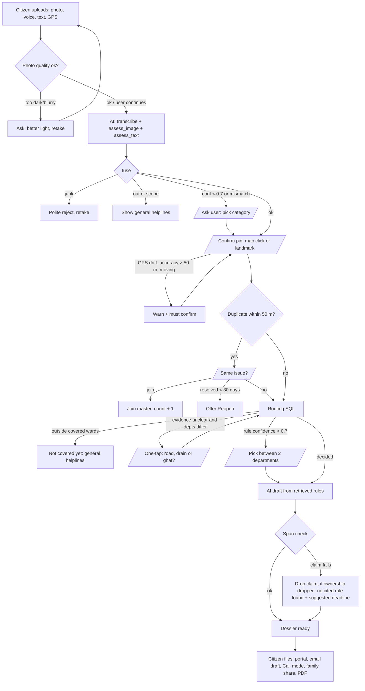
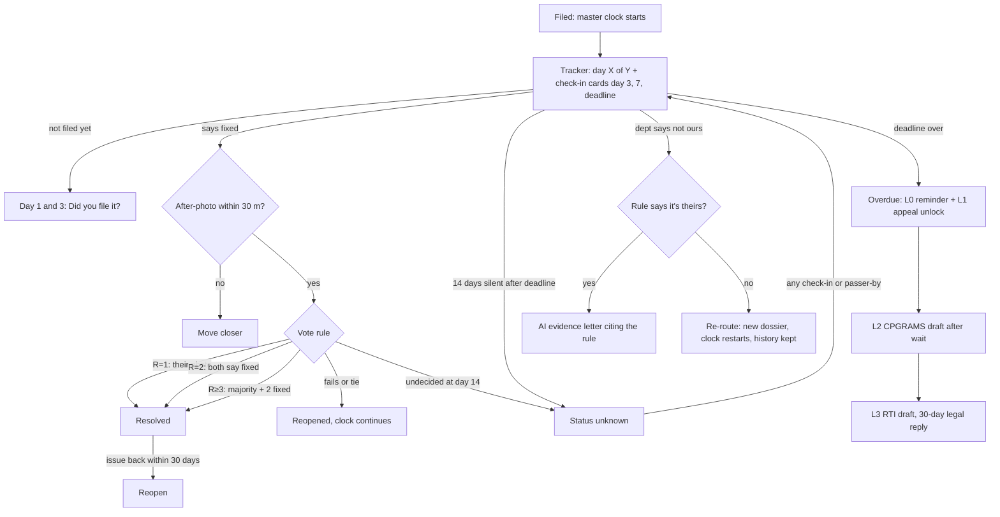

# Workflow: Agents, Engines and Every Branch

> **2026-10-25: voice input removed.** Ignore `transcribe` / Whisper / voice-note steps below. Input = photo + text + GPS.
>
> A companion to ARCHITECTURE.md, in plain words. If the two disagree, ARCHITECTURE.md wins.

## 0. System at a glance

```
                     photo · text · GPS
   citizen ─────────────────────────────┐
                                        ▼
   ┌──────────────────────────────────────────────┐
   │  Streamlit UI  (:8501)                       │
   │  camera · map pin · Hindi / English          │
   └──────────────────────────────────────────────┘
          │ POST /reports               ▲ next step
          │ (+ answers)                 │ (ask / dossier)
          ▼                             │
   ┌──────────────────────────────────────────────┐      ┌──────────────────┐
   │  FastAPI backend  (:8010)                    │ tick │  GitHub Actions  │
   │  auth · validate · call modules              │◄─────│  cron, 30 min    │
   └──────────────────────────────────────────────┘      └──────────────────┘
          │ runs graph
          ▼
   ┌──────────────────────────────────────────────┐    text     ┌──────────┐
   │  Intake agent  (LangGraph)                   │────────────►│  Groq    │
   │  understand · ask user · draft letters       │   photo     ├──────────┤
   │  pauses when unsure (interrupt)              │────────────►│  Gemini  │
   └──────────────────────────────────────────────┘             └──────────┘
          │ calls (plain Python, no AI)
          ▼
   ┌──────────────────────────────────────────────┐
   │  Engines                                     │
   │  location · dedup · routing (SQL) · rag      │
   │  dossier · tracker · votes · privacy         │
   └──────────────────────────────────────────────┘
          │ read / write
          ▼
   ┌──────────────────────────────────────────────┐
   │  Postgres  (Supabase)                        │
   │  PostGIS : wards · roads · pins              │
   │  pgvector: rule chunks · photo vectors       │
   │  tables  : reports · issues · dossiers       │
   └──────────────────────────────────────────────┘
          │ dossier (complaint + rule + deadline)
          ▼
   citizen files it: portal · email · 📞 call
```

## 1. Who does what

The system has **1 AI agent** (a LangGraph graph with 5 AI steps) and **9 plain-code engines**. The AI steps only judge language and pixels. Departments, deadlines and helplines always come from data.

### The AI agent: intake graph (LangGraph)

| Step (node) | Model | Responsibility | Output |
|---|---|---|---|
| `transcribe` | Groq Whisper-large-v3 | Hindi/English/Hinglish voice → text | transcript + language |
| `assess_image` | Gemini Flash | Category, junk check, road width (wide road vs gali), drain type (sewer vs nala), face/plate boxes | `ImageAssessment` JSON |
| `assess_text` | Groq Llama | Category, severity, landmark from the text/transcript | `TextAssessment` JSON |
| `draft` | Groq Llama | Writes the "why" sentences, complaint prose and letters, **only from retrieved rule chunks** | `{claim, citation_id, quoted_span}` list |
| `compare` (resolution) | Gemini Flash | Before/after photo comparison, **advisory only** | looks_fixed / not_fixed / unclear |

**Interrupts (the agent pauses and asks the user):** clarify category · confirm pin · confirm duplicate join · one-tap issue question (road / drain / ghat) · pick between candidate departments.

### The plain-code engines

| Engine | Responsibility |
|---|---|
| `fuse` | Merges the image and text results; confidence < 0.7 or a mismatch → ask |
| `location` | GPS drift check, pin seed (best accuracy), landmark geocoding |
| `dedup` | Same category within 50 m + CLIP image similarity ≥ 0.85 → candidate list; the user confirms |
| `routing` | SQL: ward → special zone → road snap (25 m) → PWD list → rule → confidence |
| `rag` | Hybrid search (full-text + vectors), pinned rule citations, verbatim span check (failing claims dropped) |
| `dossier` | Bilingual complaint, call script, email draft, share page + PDF/QR |
| `tracker` | Master clock, "day X of Y", escalation ladder L0–L3, rejection → evidence letter / re-route |
| `resolution` | After-photo 30 m check, vote rule by reporter count |
| `notify` + `privacy` + `jobs` | Check-in cards, self-reminder email, encryption/masking/blur, a `/jobs/tick` cron every 30 min |

## 2. Intake flow (upload → dossier)



## 3. After filing (tracker → outcome)



## 4. Background jobs

`GitHub Actions cron (every 30 min)` → `POST /jobs/tick` → `advance(master, now)` for each open master (overdue, status unknown, vote close) → create check-in cards → optional self-reminder emails (quiet hours 22:00–07:00 IST) → purge expired drafts, voice clips and PII. The same function runs on every read, so it is idempotent.

## 5. One worked example

Ramesh, 10pm, Sarita Vihar, Hindi voice note about sewage overflow, dark photo, GPS ±120 m:
1. **Quality check:** too dark → "move to better light" → he submits anyway, so the voice note becomes the main input.
2. **AI:** transcript → category = waterlogging/sewage, severity high, landmark "school ke saamne".
3. **Pin:** accuracy 120 m → warning → landmark geocoded → he confirms.
4. **Dedup:** the dark photo can't match images → location + category candidates → "Is this the same?" → joins (count 3).
5. **Routing:** drain type unclear → one tap: "Big open nala or sewer/manhole?" → sewer → DJB rule.
6. **Draft:** DJB charter clause retrieved and quoted. A deadline is cited if found, otherwise the suggested 15 days.
7. **Filing:** Call mode plays the Hindi script → he taps "Call 1916".
8. **Day 6:** someone at DJB says "not ours" → the rule says sewer = DJB → evidence letter.
9. **Day 20:** overdue → appeal draft (L1) unlocks.
